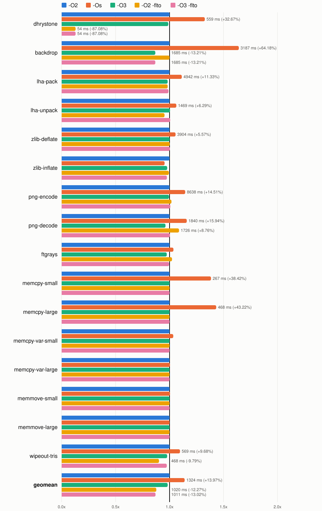
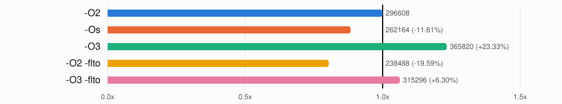

# Results

Fastest iteration in milliseconds under volamos[^volamos].
The cycle count makes all iterations identical.
Percentages are against the first column.

## Comparing m68k compilers

All runs done with benchwork-040 built with `-O2 -fomit-frame-pointer -m68040
-m68881`, or the equivalent for vbcc and SAS/C. Each compiler links its own
C library, so the memcpy and memmove rows compare the compiler together with
its runtime.

### Time relative to gcc 6.5.0b

Each bar is the compiler's time divided by gcc 6.5.0b's, so shorter is faster.

Same data in tabular form (time in milliseconds):

| benchmark | 6.5.0b | 16.2-rc17[^rc17] | vbcc 0.9i[^vbcc] | SAS/C 6.58[^sasc] |
|---|---:|---:|---:|---:|
| dhrystone | **420** | 421 (+0.25%) | 599 (+42.49%) | 581 (+38.20%) |
| backdrop | 2891 | **1941 (-32.87%)** | 4238 (+46.57%) | 4267 (+47.57%) |
| lha-pack | **4377** | 4439 (+1.42%) | 4870 (+11.26%) | 5022 (+14.73%) |
| lha-unpack | 1385 | **1382 (-0.18%)** | 1457 (+5.21%) | 1507 (+8.80%) |
| zlib-deflate | **3172** | 3698 (+16.59%) | 4274 (+34.75%) | 4096 (+29.13%) |
| zlib-inflate | **447** | 511 (+14.21%) | 551 (+23.32%) | 492 (+10.05%) |
| png-encode | **6562** | 7543 (+14.95%) | 10221 (+55.76%) | 9483 (+44.51%) |
| png-decode | **1529** | 1587 (+3.82%) | 2357 (+54.21%) | 1985 (+29.87%) |
| ftgrays | **845** | 858 (+1.56%) | failed | 942 (+11.48%) |
| memcpy-small | **186** | 193 (+4.14%) | wrong output | 348 (+87.63%) |
| memcpy-large | 328 | **326 (-0.44%)** | 1267 (+286.43%) | 501 (+52.81%) |
| memcpy-var-small | 588 | 565 (-3.92%) | 654 (+11.34%) | **423 (-27.94%)** |
| memcpy-var-large | 638 | **635 (-0.52%)** | 1616 (+153.27%) | 644 (+0.92%) |
| memmove-small | **2247** | 2351 (+4.61%) | 4320 (+92.22%) | 3110 (+38.40%) |
| memmove-large | **4011** | 4127 (+2.89%) | 12458 (+210.62%) | 8911 (+122.20%) |
| wipeout-tris | **507** | 519 (+2.38%) | 943 (+86.08%) | 672 (+32.73%) |
| nfs3-project[^cxx] | 1168 | **1064 (-8.90%)** | not built | not built |
| nfs3-clip[^cxx] | 1005 | **951 (-5.40%)** | not built | not built |
| sha512[^longlong] | **964** | 1045 (+8.38%) | 3824 (+296.79%) | not built |
| aesgcm[^longlong] | 1121 | **903 (-19.42%)** | 3290 (+193.62%) | not built |
| **GEOMEAN** | **1149** | **1162 (+1.15%)** | | **1491 (+29.74%)** |

## Comparing GCC 16.2 releases

benchwork-040 built with `-O2 -fomit-frame-pointer -m68040 -m68881` by each
AmigaPorts release[^releases] since rc5, the oldest one still published:

- rc11: LRA by default, small constant-size copies inlined.
- rc14: Bebbo's code generation work (costs, dbra, inline block copies).
- rc17: GCC 16.2.1, 64-bit integer operations split into 32-bit ones.

The chart skips the releases that time within 1% of the one before them.
Its vertical axis is logarithmic, so equal slopes are equal percentages.

| benchmark | rc5 | rc11 | rc14 | rc17 |
|---|---:|---:|---:|---:|
| dhrystone | 516 | 516 | **421 (-18.37%)** | **421 (-18.37%)** |
| backdrop | 2083 | 2082 (-0.05%) | **1941 (-6.81%)** | **1941 (-6.81%)** |
| lha-pack | **4108** | 4380 (+6.62%) | 4439 (+8.05%) | 4439 (+8.05%) |
| lha-unpack | **1330** | 1371 (+3.05%) | 1382 (+3.93%) | 1382 (+3.93%) |
| zlib-deflate | 3824 | 3822 (-0.05%) | **3698 (-3.28%)** | **3698 (-3.28%)** |
| zlib-inflate | **495** | 497 (+0.51%) | 511 (+3.21%) | 511 (+3.21%) |
| png-encode | 7913 | 7912 (-0.01%) | **7543 (-4.67%)** | **7543 (-4.67%)** |
| png-decode | 1743 | 1733 (-0.53%) | **1587 (-8.94%)** | **1587 (-8.94%)** |
| ftgrays | 860 | 862 (+0.20%) | **858 (-0.17%)** | **858 (-0.17%)** |
| memcpy-small | 514 | 476 (-7.33%) | **193 (-62.38%)** | **193 (-62.38%)** |
| memcpy-large | 505 | 505 | **326 (-35.38%)** | **326 (-35.38%)** |
| memcpy-var-small | **559** | **559** | 565 (+0.95%) | 565 (+0.95%) |
| memcpy-var-large | 636 | 636 | **635 (-0.23%)** | **635 (-0.23%)** |
| memmove-small | 2484 | 2715 (+9.27%) | **2351 (-5.36%)** | **2351 (-5.36%)** |
| memmove-large | 5053 | 5069 (+0.32%) | **4127 (-18.33%)** | **4127 (-18.33%)** |
| wipeout-tris | 666 | 538 (-19.23%) | **519 (-22.20%)** | **519 (-22.20%)** |
| nfs3-project | **1002** | 1066 (+6.39%) | 1064 (+6.19%) | 1064 (+6.19%) |
| nfs3-clip | 962 | 963 (+0.03%) | **951 (-1.17%)** | **951 (-1.17%)** |
| sha512 | **965** | 1226 (+26.99%) | 1220 (+26.35%) | 1045 (+8.21%) |
| aesgcm | 1156 | 1242 (+7.38%) | 1205 (+4.20%) | **903 (-21.92%)** |
| **GEOMEAN** | **1265** | **1282 (+1.36%)** | **1150 (-9.04%)** | **1125 (-11.03%)** |
| **CODE SIZE** | 393436 | 380648 (-3.25%) | 357496 (-9.13%) | 348252 (-11.48%) |

## Comparing GCC optimization levels

benchwork-040 built with m68k-amigaos-gcc 16.2-rc14[^gcc] and
`-fomit-frame-pointer -m68040 -m68881` at each level, and with link-time
optimization at -O2 and -O3.

### GCC 16.2 optimization levels

Each bar is the build's time divided by `-O2`'s, so shorter is faster. The
Dhrystone LTO bars do not measure faster code[^dhry-lto].

Same data in tabular form (time in milliseconds):

| benchmark | -O2 | -Os | -O3 | -O2 -flto | -O3 -flto |
|---|---:|---:|---:|---:|---:|
| dhrystone[^dhry-lto] | 421 | 559 (+32.67%) | 416 (-1.14%) | **54 (-87.08%)** | **54 (-87.08%)** |
| backdrop | 1941 | 3187 (+64.18%) | **1685 (-13.21%)** | 1941 | 1705 (-12.16%) |
| lha-pack | 4439 | 4942 (+11.33%) | **4360 (-1.78%)** | **4360 (-1.79%)** | 4396 (-0.97%) |
| lha-unpack | 1382 | 1469 (+6.29%) | 1389 (+0.45%) | **1318 (-4.65%)** | 1390 (+0.59%) |
| zlib-deflate | **3698** | 3904 (+5.57%) | 3701 (+0.08%) | 3706 (+0.21%) | 3712 (+0.36%) |
| zlib-inflate | 511 | **487 (-4.61%)** | 499 (-2.19%) | 507 (-0.61%) | 498 (-2.46%) |
| png-encode | 7543 | 8638 (+14.51%) | **7508 (-0.47%)** | 7675 (+1.75%) | 7529 (-0.19%) |
| png-decode | 1587 | 1840 (+15.94%) | **1527 (-3.78%)** | 1726 (+8.76%) | 1593 (+0.38%) |
| ftgrays | 858 | 889 (+3.58%) | **836 (-2.60%)** | 878 (+2.26%) | 855 (-0.37%) |
| memcpy-small | **193** | 267 (+38.42%) | **193** | **193** | **193** |
| memcpy-large | **326** | 468 (+43.22%) | **326** | **326** | **326** |
| memcpy-var-small | **565** | 584 (+3.44%) | **565** | **565** | **565** |
| memcpy-var-large | **635** | 637 (+0.41%) | **635** | **635** | **635** |
| memmove-small | **2351** | 2361 (+0.44%) | **2351** | **2351** | **2351** |
| memmove-large | **4127** | 4128 (+0.02%) | **4127** | **4127** | **4127** |
| wipeout-tris | 519 | 569 (+9.68%) | 507 (-2.23%) | **468 (-9.79%)** | 505 (-2.57%) |
| nfs3-project | 1064 | 2604 (+144.74%) | 872 (-18.04%) | **866 (-18.61%)** | 870 (-18.23%) |
| nfs3-clip | 951 | 2355 (+147.55%) | 858 (-9.79%) | 868 (-8.73%) | **818 (-13.99%)** |
| sha512 | 1220 | **1077 (-11.66%)** | 1201 (-1.51%) | 1226 (+0.51%) | 1201 (-1.51%) |
| aesgcm | 1205 | 1203 (-0.12%) | **1195 (-0.79%)** | 1213 (+0.70%) | 1269 (+5.30%) |
| **GEOMEAN** | **1150** | **1389 (+20.73%)** | **1116 (-2.98%)** | **1021 (-11.22%)** | **1013 (-11.95%)** |
| **CODE SIZE** | 357476 | 316760 (-11.39%) | 514312 (+43.87%) | 290128 (-18.84%) | 446524 (+24.91%) |

The run-time-sized copies and the moves call newlib's assembler routines,
which do not change with the level. The constant-size copies are expanded
inline at every level, but `-Os` turns more of them into loops where `-O2`
and `-O3` unroll. `-Os` also keeps the NFS3 kernels' `GuardedFloatMath`
operations out of line, so every float operation there becomes a call.

Link-time optimization cannot reach newlib, which is built separately, so
it mostly helps where a hot loop calls a function in another of our source
files: LHa's bit I/O and Huffman coders, and the wipeout kernel. The NFS3
kernels gain too, although each lives in a single file. Apart from
Dhrystone, `-O2 -flto` is 1.74% faster than `-O2`, most of it in the NFS3
kernels, although png-decode loses 8.76%; `-O3 -flto` is 0.50% slower than
`-O3`, losing most in aesgcm (6.19%) and png-decode (4.32%). LTO does
shrink the code, by a fifth at `-O2`.

### Code size relative to -O2

The text size of each binary in bytes, as `m68k-amigaos-size` reports it.

## Comparing GCC code generation for 68000, 68020, 68040-FP

The three release binaries, built with
m68k-amigaos-gcc 16.2-rc14[^gcc] by `make release`, all run on the same
emulated 68040. The columns therefore show what the compiler gains from
being allowed each CPU's instructions, not how fast those CPUs are.

| benchmark | 68000 | 68020 | 68040-FP |
|---|---:|---:|---:|
| dhrystone | 452 | 420 (-7.07%) | 421 (-6.90%) |
| backdrop | 9805 | 1978 (-79.82%) | 1941 (-80.20%) |
| lha-pack | 4974 | 4515 (-9.23%) | 4439 (-10.76%) |
| lha-unpack | 1454 | 1393 (-4.21%) | 1382 (-4.91%) |
| zlib-deflate | 3899 | 3736 (-4.17%) | 3698 (-5.14%) |
| zlib-inflate | 526 | 481 (-8.50%) | 511 (-2.86%) |
| png-encode | 7905 | 7733 (-2.16%) | 7543 (-4.57%) |
| png-decode | 1893 | 1602 (-15.39%) | 1587 (-16.18%) |
| ftgrays | 1477 | 864 (-41.47%) | 858 (-41.87%) |
| memcpy-small | 452 | 202 (-55.19%) | 193 (-57.23%) |
| memcpy-large | 740 | 327 (-55.80%) | 326 (-55.90%) |
| memcpy-var-small | 587 | 565 (-3.75%) | 565 (-3.75%) |
| memcpy-var-large | 647 | 634 (-2.11%) | 635 (-1.93%) |
| memmove-small | 2362 | 2351 (-0.44%) | 2351 (-0.44%) |
| memmove-large | 4137 | 4127 (-0.25%) | 4127 (-0.25%) |
| wipeout-tris[^softfloat] | 879 | 810 (-7.89%) | 519 (-41.00%) |
| nfs3-project[^softfloat] | 2480 | 2436 (-1.77%) | 1064 (-57.10%) |
| nfs3-clip[^softfloat] | 2127 | 2027 (-4.70%) | 951 (-55.28%) |
| sha512 | 1240 | 1193 (-3.75%) | 1220 (-1.60%) |
| aesgcm | 1318 | 1274 (-3.30%) | 1205 (-8.56%) |
| **GEOMEAN** | **1610** | **1281 (-20.45%)** | **1150 (-28.54%)** |

[^volamos]: volamos 0.9.0 (0.10.0 for most release runs, which agrees to
    within 2 us), `volamos --clock-mhz 25 --cpu 68040 --fpu <binary> -n 1`
    for every column. The emulated time is
    derived from the CPU's cycle count at 25 MHz; native library calls cost
    no cycles. The geomean is computed from the rows by
    `tools/results-table.py`, not taken from the binary.
[^gcc]: `m68k-amigaos-gcc (AmigaDev v16.2-rc14) 16.2.0b 20260825082934`,
    the AmigaPorts 16.2-rc14 release, with its default newlib runtime. 6.5.0b
    is `m68k-amigaos-gcc (GCC) 6.5.0b 20260819091705`, also with newlib. The
    040 build says `-m68881` rather than its synonym `-mhard-float` because
    only the former selects the hard-float multilib in rc14.
[^rc17]: `m68k-amigaos-gcc (AmigaDev v16.2-rc17) 16.2.1b 20261010182711`,
    with its default newlib runtime.
[^releases]: The released x86_64 Linux tarballs, with their default newlib
    runtime. Code size is the text size `m68k-amigaos-size` reports.
[^vbcc]: `vbcc V0.9i pre` from the same toolchain, `make vbcc-release`:
    `vc +aos68k -O2 -cpu=68040 -fpu=68040` with vc.lib, m040.lib and
    amiga.lib. vbcc 0.9i miscompiles two of the drivers: ftgrays fails
    before it runs, and memcpy-small produces a wrong checksum and writes
    outside its buffers, which is why no geomean is given.
[^sasc]: SAS/C 6.58, `make sasc-release`: `CPU=68040 MATH=68881` with
    `OPTIMIZE OPTIMIZERTIME OPTIMIZERINLINELOCAL OPTIMIZERSCHEDULER` and the
    optimizer depths at 8, `PARAMETERS=REGISTERS CODE=FAR DATA=FAR`, linked
    with scm040.lib, sc.lib and amiga.lib.
[^dhry-lto]: Dhrystone splits its procedures between dhry_1.c and
    dhry_2.c so that the compiler cannot inline across them. LTO defeats
    that, and the 54 ms does not measure a faster CPU or better code
    generation.
[^softfloat]: The 68000 and 68020 builds are soft float, and newlib's float
    arithmetic is a stub into the mathieeesingbas ROM library, which volamos
    runs natively at zero cycles: 370,000 calls in wipeout-tris, and most of
    the work of the NFS3 kernels. Those two columns measure everything in
    these benchmarks except their float math.
[^cxx]: The NFS3 kernels are C++, which of these compilers only gcc builds.
    The geomean of this table leaves them out, so that it covers the same
    benchmarks for every compiler; the other tables include them.
[^longlong]: SHA-512 and GHASH are built on 64-bit integers, and SAS/C 6.58
    has no `long long`. The geomean of this table leaves them out as it does
    the NFS3 kernels.
