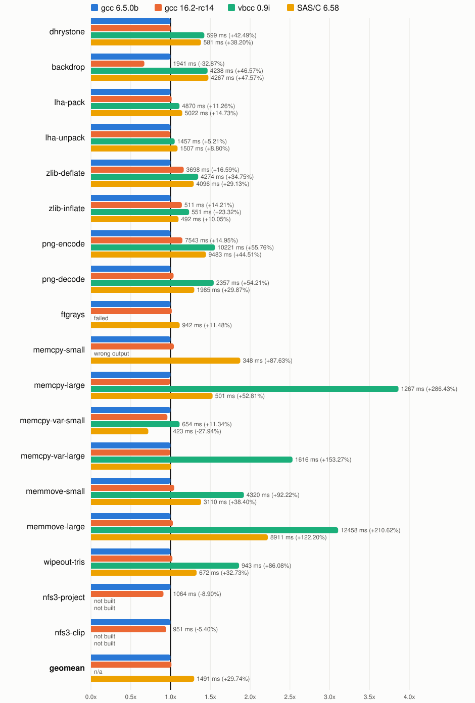
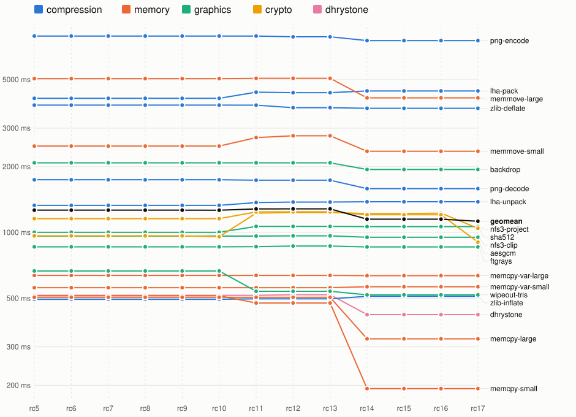
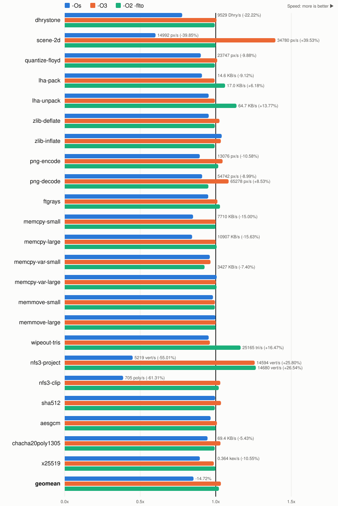
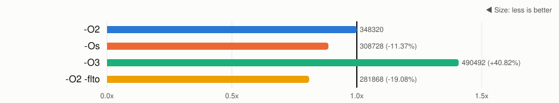

# Results

Fastest iteration in milliseconds under [volamos](https://github.com/sidick/volamos) 0.11.0.
The cycle count makes all iterations identical.
Percentages are against the first column.

## Comparing m68k compilers

All runs done with benchwork-040 built with `-O2 -fomit-frame-pointer -m68040
-m68881`, or the equivalent for vbcc and SAS/C. Each compiler links its own
C library, so the memcpy and memmove rows compare the compiler together with
its runtime.

### Time relative to gcc 6.5.0b

Each bar is the compiler's time divided by gcc 6.5.0b's, so shorter is faster.

Same data in tabular form (time in milliseconds):

| benchmark | 6.5.0b[^gcc6] | 16.2-rc18[^rc18] | vbcc 0.9i[^vbcc] | SAS/C 6.58[^sasc] |
|---|---:|---:|---:|---:|
| dhrystone | **420** | **420 (+0.06%)** | 599 (+42.49%) | 581 (+38.21%) |
| backdrop | 3976 | **3137 (-21.12%)** | 5849 (+47.09%) | 5611 (+41.10%) |
| lha-pack | **4377** | 4439 (+1.42%) | 4870 (+11.26%) | 4951 (+13.12%) |
| lha-unpack | 1385 | **1383 (-0.13%)** | 1457 (+5.21%) | 1512 (+9.16%) |
| zlib-deflate | **3172** | 3698 (+16.59%) | 4274 (+34.75%) | 4096 (+29.13%) |
| zlib-inflate | **447** | 509 (+13.77%) | 551 (+23.32%) | 492 (+10.05%) |
| png-encode | **1971** | 2247 (+14.02%) | 3010 (+52.70%) | 2771 (+40.61%) |
| png-decode | **467** | 501 (+7.21%) | 706 (+51.26%) | 592 (+26.72%) |
| ftgrays | **845** | 858 (+1.56%) | failed | 942 (+11.48%) |
| memcpy-small | **186** | 193 (+4.14%) | wrong output | 348 (+87.63%) |
| memcpy-large | 328 | **326 (-0.44%)** | 1267 (+286.43%) | 501 (+52.81%) |
| memcpy-var-small | 588 | 565 (-3.92%) | 654 (+11.34%) | **423 (-27.94%)** |
| memcpy-var-large | 638 | **635 (-0.52%)** | 1616 (+153.27%) | 644 (+0.92%) |
| memmove-small | 2247 | **1920 (-14.58%)** | 4320 (+92.22%) | 3110 (+38.40%) |
| memmove-large | 4011 | **1481 (-63.08%)** | 12458 (+210.62%) | 8911 (+122.20%) |
| wipeout-tris | **507** | 518 (+2.34%) | 943 (+86.08%) | 672 (+32.73%) |
| nfs3-project[^cxx] | 1168 | **1064 (-8.90%)** | not built | not built |
| nfs3-clip[^cxx] | 1005 | **952 (-5.33%)** | not built | not built |
| sha512[^longlong] | **959** | 960 (+0.09%) | 3824 (+298.80%) | not built |
| aesgcm[^longlong] | 1121 | **903 (-19.39%)** | 3290 (+193.62%) | not built |
| chacha20poly1305[^longlong] | **428** | 450 (+5.07%) | 1092 (+155.09%) | not built |
| x25519[^longlong] | **539** | 547 (+1.53%) | failed | not built |
| **GEOMEAN** | **1010** | **956 (-5.26%)** | | **1301 (+28.87%)** |

## Comparing GCC 16.2 releases

benchwork-040 built with `-O2 -fomit-frame-pointer -m68040 -m68881` by each
AmigaPorts release[^releases] since rc5, the oldest one still published:

- rc11: LRA by default, small constant-size copies inlined.
- rc14: Bebbo's code generation work (costs, dbra, inline block copies).
- rc17: GCC 16.2.1, 64-bit integer operations split into 32-bit ones.
- rc18: newlib upstream merge (memmove), 68040 cost fix (sha512),
  `-m68020-60` multilibs.

All tests ran on an emulated 25MHz 68040, except where noted[^volamos].

The chart skips the releases that time within 1% of the one before them.
Its vertical axis is logarithmic, so equal slopes are equal percentages.

| benchmark | rc5 | rc11 | rc14 | rc17 | rc18 |
|---|---:|---:|---:|---:|---:|
| dhrystone | 516 | 516 | 421 (-18.37%) | 421 (-18.37%) | **420 (-18.53%)** |
| backdrop | 3768 | 3798 (+0.80%) | **3137 (-16.76%)** | **3137 (-16.76%)** | **3137 (-16.76%)** |
| lha-pack | **4108** | 4380 (+6.62%) | 4439 (+8.05%) | 4439 (+8.05%) | 4439 (+8.05%) |
| lha-unpack | **1330** | 1371 (+3.05%) | 1382 (+3.93%) | 1382 (+3.93%) | 1383 (+3.98%) |
| zlib-deflate | 3824 | 3822 (-0.05%) | **3698 (-3.28%)** | **3698 (-3.28%)** | **3698 (-3.28%)** |
| zlib-inflate | **495** | 497 (+0.51%) | 511 (+3.21%) | 511 (+3.21%) | 509 (+2.81%) |
| png-encode | 2332 | 2330 (-0.07%) | **2247 (-3.61%)** | **2247 (-3.61%)** | **2247 (-3.61%)** |
| png-decode | 535 | 532 (-0.49%) | **500 (-6.49%)** | **500 (-6.49%)** | 501 (-6.41%) |
| ftgrays | 860 | 862 (+0.20%) | **858 (-0.17%)** | **858 (-0.17%)** | **858 (-0.16%)** |
| memcpy-small | 514 | 476 (-7.33%) | **193 (-62.38%)** | **193 (-62.38%)** | **193 (-62.38%)** |
| memcpy-large | 505 | 505 | **326 (-35.38%)** | **326 (-35.38%)** | **326 (-35.38%)** |
| memcpy-var-small | **559** | **559** | 565 (+0.95%) | 565 (+0.95%) | 565 (+0.95%) |
| memcpy-var-large | 636 | 636 | **635 (-0.23%)** | **635 (-0.23%)** | **635 (-0.23%)** |
| memmove-small | 2484 | 2715 (+9.27%) | 2351 (-5.36%) | 2351 (-5.36%) | **1920 (-22.72%)** |
| memmove-large | 5053 | 5069 (+0.32%) | 4127 (-18.33%) | 4127 (-18.33%) | **1481 (-70.69%)** |
| wipeout-tris | 666 | 538 (-19.23%) | 519 (-22.20%) | 519 (-22.20%) | **518 (-22.22%)** |
| nfs3-project | **1002** | 1066 (+6.39%) | 1064 (+6.19%) | 1064 (+6.19%) | 1064 (+6.19%) |
| nfs3-clip | 962 | 963 (+0.03%) | **951 (-1.17%)** | **951 (-1.17%)** | 952 (-1.10%) |
| sha512 | **957** | 1234 (+29.03%) | 1220 (+27.49%) | 1045 (+9.19%) | 960 (+0.32%) |
| aesgcm | 1156 | 1242 (+7.38%) | 1205 (+4.20%) | **903 (-21.92%)** | **903 (-21.89%)** |
| chacha20poly1305 | **433** | 446 (+3.00%) | 450 (+3.92%) | 450 (+3.92%) | 450 (+3.92%) |
| x25519 | **494** | 515 (+4.25%) | 546 (+10.64%) | 547 (+10.81%) | 547 (+10.76%) |
| **GEOMEAN** | **1063** | **1080 (+1.67%)** | **978 (-7.95%)** | **959 (-9.78%)** | **903 (-15.02%)** |
| **CODE SIZE** | 446788 | 434460 (-2.76%) | 411300 (-7.94%) | 401816 (-10.07%) | 401948 (-10.04%) |

## Comparing GCC optimization levels

benchwork built with m68k-amigaos-gcc 16.2-rc18[^rc18] and
`-fomit-frame-pointer -m68030 -m68881` at each level, run on a 68030 with
its 256-byte instruction cache modeled[^cache].

### GCC 16.2 optimization levels

Each bar is the build's time divided by `-O2`'s. The Dhrystone LTO bar
does not measure faster code[^dhry-lto].

| benchmark | -O2 | -Os | -O3 | -O2 -flto |
|---|---:|---:|---:|---:|
| dhrystone[^dhry-lto] | 1668 | 2123 (+27.24%) | 1643 (-1.53%) | **242 (-85.52%)** |
| backdrop | 12792 | 16765 (+31.06%) | **9226 (-27.87%)** | 12782 (-0.08%) |
| lha-pack | 15967 | 17601 (+10.23%) | 16089 (+0.76%) | **15122 (-5.29%)** |
| lha-unpack | 5134 | 5347 (+4.14%) | 5159 (+0.49%) | **4590 (-10.60%)** |
| zlib-deflate | 13445 | 14113 (+4.96%) | **13094 (-2.61%)** | 13613 (+1.25%) |
| zlib-inflate | 1765 | **1728 (-2.09%)** | 1731 (-1.95%) | 1762 (-0.19%) |
| png-encode | 7685 | 8389 (+9.16%) | **7410 (-3.58%)** | 7687 (+0.02%) |
| png-decode | 1838 | 1939 (+5.51%) | **1766 (-3.89%)** | 1980 (+7.76%) |
| ftgrays | 3364 | 3502 (+4.10%) | **3337 (-0.81%)** | 3392 (+0.81%) |
| memcpy-small | 1138 | 1313 (+15.39%) | 1138 | **1136 (-0.20%)** |
| memcpy-large | **1933** | 2257 (+16.79%) | **1933** | 1938 (+0.28%) |
| memcpy-var-small | 2348 | 2263 (-3.62%) | **2195 (-6.53%)** | 2286 (-2.67%) |
| memcpy-var-large | **3040** | 3046 (+0.19%) | 3058 (+0.58%) | 3058 (+0.59%) |
| memmove-small | 6300 | 6344 (+0.69%) | 6327 (+0.43%) | **6273 (-0.43%)** |
| memmove-large | 6170 | 6175 (+0.08%) | 6168 (-0.03%) | **6165 (-0.07%)** |
| wipeout-tris | 2043 | 2115 (+3.51%) | 2090 (+2.30%) | **1976 (-3.30%)** |
| nfs3-project | 4310 | 9580 (+122.27%) | **3426 (-20.51%)** | 3430 (-20.42%) |
| nfs3-clip | 3293 | 8571 (+160.26%) | **3196 (-2.96%)** | 3228 (-1.98%) |
| sha512 | 4729 | 4718 (-0.23%) | **4695 (-0.71%)** | 4727 (-0.05%) |
| aesgcm | 3626 | 3748 (+3.35%) | **3600 (-0.74%)** | 3647 (+0.56%) |
| chacha20poly1305 | 1924 | 2025 (+5.21%) | **1871 (-2.75%)** | 1944 (+1.01%) |
| x25519 | **2457** | 2747 (+11.79%) | 2488 (+1.28%) | 2459 (+0.09%) |
| **GEOMEAN** | **3681** | **4241 (+15.20%)** | **3552 (-3.50%)** | **3316 (-9.91%)** |
| **CODE SIZE** | 403920 | 364044 (-9.87%) | 563116 (+39.41%) | 335588 (-16.92%) |

`-Os` turns constant-size copies into loops and keeps the NFS3 kernels'
`GuardedFloatMath` operations out of line, which more than doubles their
time. `-O3`'s larger loops no longer fit the cache in LHa and wipeout,
which lose up to 2.3%, but it still wins overall. LTO helps where a hot loop
calls into another file (LHa, wipeout, NFS3), costs png-decode 7.8%, and
cuts the code by a sixth.

### Code size relative to -O2

## Comparing GCC register arguments

`-mregparm=2`, `-mregparm=4` and `-msasregparm` against stack arguments:
[results/regparm.md](results/regparm.md).

## Comparing GCC code generation for 68000, 68020, 68020-60-FP, 68040-FP

The release binaries that run on a 68040, built with
m68k-amigaos-gcc 16.2-rc18[^rc18] by `make release`, all run on the same
emulated 68040[^volamos]. The columns therefore show what the compiler gains from
being allowed each CPU's instructions, not how fast those CPUs are.
68020-60-FP is benchwork-020-060fp, built with `-m68020-60 -m68881`, which
runs on any 68020 or later with an FPU.

`-m68020-60` cannot use the 64-bit `mulu.l`, which the 68060 lacks, so
chacha20poly1305 and x25519 call `__muldi3`, which multiplies 16 bits at a
time. Inlining that multiply (AmigaPorts/gcc#112, not in rc18) brings them
down to 747 and 1959 ms.

| benchmark | 68000 | 68020 | 68020-60-FP | 68040-FP |
|---|---:|---:|---:|---:|
| dhrystone | 452 | 420 (-7.07%) | 420 (-7.07%) | 420 (-7.07%) |
| backdrop | 11500 | 3230 (-71.91%) | 3087 (-73.16%) | 3137 (-72.73%) |
| lha-pack | 4986 | 4515 (-9.44%) | 4439 (-10.97%) | 4439 (-10.97%) |
| lha-unpack | 1454 | 1393 (-4.20%) | 1383 (-4.91%) | 1383 (-4.91%) |
| zlib-deflate | 3899 | 3736 (-4.17%) | 3698 (-5.14%) | 3698 (-5.14%) |
| zlib-inflate | 526 | 481 (-8.50%) | 507 (-3.51%) | 509 (-3.24%) |
| png-encode | 2375 | 2311 (-2.72%) | 2247 (-5.38%) | 2247 (-5.38%) |
| png-decode | 580 | 496 (-14.48%) | 500 (-13.68%) | 501 (-13.64%) |
| ftgrays | 1477 | 864 (-41.47%) | 858 (-41.87%) | 858 (-41.87%) |
| memcpy-small | 452 | 202 (-55.19%) | 193 (-57.23%) | 193 (-57.23%) |
| memcpy-large | 741 | 327 (-55.83%) | 326 (-55.92%) | 326 (-55.92%) |
| memcpy-var-small | 608 | 565 (-7.17%) | 565 (-7.17%) | 565 (-7.17%) |
| memcpy-var-large | 650 | 634 (-2.56%) | 635 (-2.39%) | 635 (-2.39%) |
| memmove-small | 1970 | 1920 (-2.55%) | 1920 (-2.55%) | 1920 (-2.55%) |
| memmove-large | 1929 | 1481 (-23.25%) | 1481 (-23.25%) | 1481 (-23.25%) |
| wipeout-tris[^softfloat] | 879 | 810 (-7.89%) | 518 (-41.02%) | 518 (-41.02%) |
| nfs3-project[^softfloat] | 2474 | 2430 (-1.78%) | 1064 (-56.99%) | 1064 (-56.99%) |
| nfs3-clip[^softfloat] | 2121 | 2021 (-4.71%) | 955 (-54.98%) | 952 (-55.11%) |
| sha512 | 1023 | 954 (-6.79%) | 954 (-6.79%) | 960 (-6.19%) |
| aesgcm | 1028 | 887 (-13.69%) | 902 (-12.26%) | 903 (-12.13%) |
| chacha20poly1305 | 1666 | 441 (-73.53%) | 1035 (-37.86%) | 450 (-73.00%) |
| x25519 | 5252 | 556 (-89.41%) | 2967 (-43.52%) | 547 (-89.59%) |
| **GEOMEAN** | **1446** | **992 (-31.39%)** | **1012 (-30.05%)** | **903 (-37.57%)** |
| **CODE SIZE** | 429348 | 415672 (-3.19%) | 407212 (-5.16%) | 401948 (-6.38%) |

### On a 68060

There is no point in building with `-m68060` yet: until GCC gets 68060
cost tables, it generates practically the same code as `-m68020-60`,
which also runs on every other 68020+. Emulated 50 MHz 68060 with its
caches modeled[^cache], built by rc18[^rc18] with
`volamos --clock-mhz 50 --cpu 68060 --fpu --cache`:

| benchmark | -m68020-60 -m68881 | -m68060 -m68881 |
|---|---:|---:|
| dhrystone | **256** | **256** |
| backdrop | **1790** | **1790** |
| lha-pack | **2539** | **2539** |
| lha-unpack | **757** | 759 (+0.30%) |
| zlib-deflate | **2034** | **2034** |
| zlib-inflate | **268** | **268** |
| png-encode | **1207** | **1207** |
| png-decode | **243** | **243** |
| ftgrays | **458** | **458** |
| memcpy-small | **97** | **97** |
| memcpy-large | **155** | **155** |
| memcpy-var-small | **329** | **329** |
| memcpy-var-large | **288** | **288** |
| memmove-small | **844** | **844** |
| memmove-large | **604** | **604** |
| wipeout-tris | **264** | **264** |
| nfs3-project | **616** | **616** |
| nfs3-clip | **532** | **532** |
| sha512 | 480 | **477 (-0.64%)** |
| aesgcm | **464** | **464** |
| chacha20poly1305 | **446** | **446** |
| x25519 | **1208** | **1208** |
| **GEOMEAN** | **516** | **516 (-0.02%)** |
| **CODE SIZE** | 407212 | 406552 (-0.16%) |

[^volamos]: `volamos --clock-mhz 25 --cpu 68040 --fpu <binary> -n 1`.
    The emulated time is derived from the CPU's cycle count at 25 MHz;
    native library calls cost no cycles.
[^gcc6]: `m68k-amigaos-gcc (GCC) 6.5.0b 20260819091705`, with newlib.
[^rc18]: `m68k-amigaos-gcc (AmigaDev v16.2-rc18) 16.2.1b 20261010182711`,
    with its default newlib runtime.
[^releases]: The released x86_64 Linux tarballs, with their default newlib
    runtime. Code size is the text size `m68k-amigaos-size` reports.
[^vbcc]: `vbcc V0.9i pre` from the same toolchain, `make vbcc-release`:
    `vc +aos68k -O2 -cpu=68040 -fpu=68040` with vc.lib, m040.lib and
    amiga.lib. vbcc 0.9i miscompiles three of the benchmarks: ftgrays
    fails before it runs, x25519 fails its self-test (from `-O1` up), and
    memcpy-small produces a wrong checksum and writes outside its buffers,
    which is why no geomean is given.
[^sasc]: SAS/C 6.58, `make sasc-release`: `CPU=68040 MATH=68881` with
    `OPTIMIZE OPTIMIZERTIME OPTIMIZERINLINELOCAL OPTIMIZERSCHEDULER` and the
    optimizer depths at 8, `PARAMETERS=REGISTERS CODE=FAR DATA=FAR`, linked
    with scm040.lib, sc.lib and amiga.lib.
[^dhry-lto]: Dhrystone splits its procedures between dhry_1.c and
    dhry_2.c so that the compiler cannot inline across them. LTO defeats
    that, and its LTO time does not measure a faster CPU or better code
    generation.
[^cache]: volamos `--cache`: a direct-mapped instruction cache, so a miss
    costs a memory fetch. It does not model the data cache or bus wait
    states, nor yet the 68040, so the other sections run without it.
[^softfloat]: The 68000 and 68020 builds are soft float, and newlib's
    float arithmetic is a stub into the mathieeesingbas ROM library, which
    volamos runs natively at zero cycles: 370,000 calls in wipeout-tris,
    and most of the work of the NFS3 kernels. Those two columns measure
    everything in these benchmarks except their float math.
[^cxx]: The NFS3 kernels are C++, which of these compilers only gcc builds.
    The geomean of this table leaves them out, so that it covers the same
    benchmarks for every compiler; the other tables include them.
[^longlong]: SHA-512, GHASH, Poly1305 and X25519 are built on 64-bit
    integers, and SAS/C 6.58
    has no `long long`. The geomean of this table leaves them out as it does
    the NFS3 kernels.
