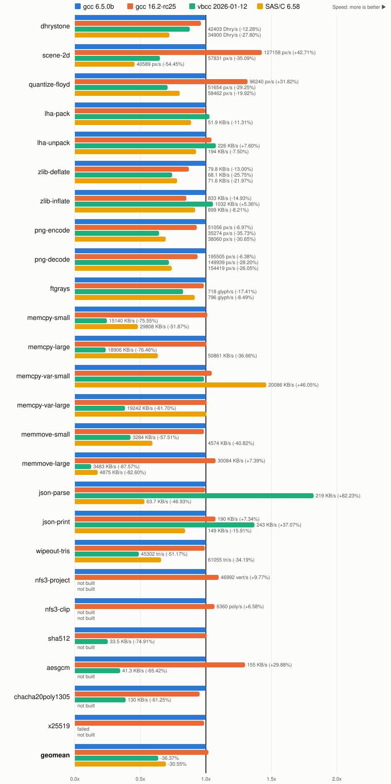

# Comparing m68k compilers

Part of the [Benchwork results](README.md); see there for how they are
measured.

All runs done with benchwork-040: gcc with `-O2 -fomit-frame-pointer -m68040
-m68881`, vbcc and SAS/C with their full optimizers for the 68040 (see the
notes under the table). Each compiler links its own
C library, so the memcpy and memmove rows compare the compiler together with
its runtime.

## Speed relative to gcc 6.5.0b

Each bar is gcc 6.5.0b's time divided by the compiler's, so longer is faster.

Same data in tabular form (time in milliseconds):

| benchmark | 6.5.0b[^gcc6] | 16.2-rc25[^rc25] | vbcc 2026-01-12[^vbcc] | SAS/C 6.58[^sasc] |
|---|---:|---:|---:|---:|
| dhrystone | **414** | 430 (+3.93%) | 472 (+14.00%) | 573 (+38.51%) |
| scene-2d | 1437 | **1007 (-29.93%)** | 2213 (+54.07%) | 3154 (+119.52%) |
| quantize-floyd | 877 | **665 (-24.14%)** | 1239 (+41.34%) | 1095 (+24.88%) |
| lha-pack | 1094 | 1099 (+0.45%) | **1064 (-2.66%)** | 1233 (+12.75%) |
| lha-unpack | 305 | 292 (-4.12%) | **283 (-7.06%)** | 329 (+8.11%) |
| zlib-deflate | **698** | 802 (+14.95%) | 940 (+34.69%) | 894 (+28.16%) |
| zlib-inflate | 196 | 230 (+17.55%) | **186 (-5.09%)** | 213 (+8.95%) |
| png-encode | **1166** | 1254 (+7.50%) | 1814 (+55.59%) | 1682 (+44.20%) |
| png-decode | **919** | 982 (+6.81%) | 1281 (+39.27%) | 1243 (+35.23%) |
| ftgrays | **649** | 659 (+1.65%) | 785 (+21.08%) | 709 (+9.28%) |
| memcpy-small | 862 | **852 (-1.07%)** | 3525 (+309.02%) | 1790 (+107.75%) |
| memcpy-large | 286 | **285 (-0.45%)** | 1214 (+324.73%) | 451 (+57.88%) |
| memcpy-var-small | 546 | 523 (-4.22%) | 554 (+1.45%) | **374 (-31.53%)** |
| memcpy-var-large | 596 | **593 (-0.56%)** | 1557 (+161.11%) | 594 (-0.34%) |
| memmove-small | **906** | 920 (+1.55%) | 2132 (+135.37%) | 1530 (+68.98%) |
| memmove-large | 1028 | **957 (-6.88%)** | 8270 (+704.40%) | 5908 (+474.65%) |
| json-parse | 406 | 409 (+0.61%) | **223 (-45.13%)** | 765 (+88.44%) |
| json-print | 275 | 256 (-6.84%) | **201 (-27.05%)** | 327 (+18.92%) |
| wipeout-tris | **883** | 890 (+0.79%) | 1808 (+104.79%) | 1342 (+51.95%) |
| nfs3-project[^cxx] | 1168 | **1064 (-8.90%)** | not built | not built |
| nfs3-clip[^cxx] | 1005 | **943 (-6.17%)** | not built | not built |
| sha512[^longlong] | 959 | **953 (-0.63%)** | 3822 (+298.55%) | not built |
| aesgcm[^longlong] | 1073 | **826 (-23.01%)** | 3102 (+189.21%) | not built |
| chacha20poly1305[^longlong] | **380** | 399 (+5.02%) | 982 (+158.09%) | not built |
| x25519[^longlong] | **539** | 546 (+1.34%) | failed | not built |
| **GEOMEAN** | **622** | **611 (-1.84%)** | **978 (+57.17%)** | **896 (+43.99%)** |

[^gcc6]: gcc 6.5.0b 20260819091705, with newlib, built from AmigaPorts'
    m68k-amigaos-gcc at f34b4e1, whose gcc 6 fixes include one for a
    miscompile of zlib's deflate. (Its `--version` says `AmigaDev
    v16.2-rc18-21-gf34b4e1`, the toolchain tree's own version.)
[^rc25]: `m68k-amigaos-gcc (AmigaDev 16.2-rc25) 16.2.1b 20261010182711`,
    with its default newlib runtime.
[^vbcc]: vbcc from Volker Barthelmann's source release of 2026-01-12, as
    16.2-rc20 ships it (it reports `vbcc V0.9i pre`), with rc18's vc, vc.lib,
    m040.lib and amiga.lib: `make vbcc-release`, that is `vc +aos68k -O3
    -cpu=68040 -fpu=68040`. Only `-O3` inlines, unrolls and optimizes
    across functions. Wipeout's kernel.c is built at `-O2`, as `-O3` crashes
    vbcc on it. x25519 fails its self-test (miscompiled from `-O1` up).
[^sasc]: SAS/C 6.58, `make sasc-release`: `CPU=68040 MATH=68881` with
    `OPTIMIZE OPTIMIZERTIME OPTIMIZERINLINELOCAL OPTIMIZERSCHEDULER` and the
    optimizer depths at 8, `PARAMETERS=REGISTERS CODE=FAR DATA=FAR`, linked
    with scm040.lib, sc.lib and amiga.lib.
[^cxx]: The NFS3 kernels are C++, which of these compilers only gcc builds.
    The geomean of this table leaves them out, so that it covers the same
    benchmarks for every compiler; the other tables include them.
[^longlong]: SHA-512, GHASH, Poly1305 and X25519 are built on 64-bit
    integers, and SAS/C 6.58 has no `long long`. The geomean of this table
    leaves them out as it does the NFS3 kernels.
