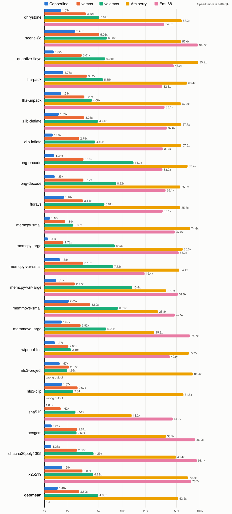

# Comparing m68k emulators

Part of the [Benchwork results](README.md); unlike the other pages, this
one measures the emulators rather than the code they run.

The benchwork-040 release binary, built with m68k-amigaos-gcc
16.2-rc18[^rc18], runs on each emulator's JIT or fastest interpreter on one
host, an AMD Ryzen AI 9 HX 370 under Linux held at its nominal 2 GHz,
except Emu68, which runs on the Raspberry Pi of a PiStorm. The
first column is the same binary on a 25 MHz 68040, as measured by every
other page, and each cell says how many times faster than that 68040 the
emulator ran.

Each bar is the 68040's time divided by the emulator's, so longer is
faster. The axis is logarithmic: the emulators are up to two orders of
magnitude apart.

Same data in tabular form (time in milliseconds):

| benchmark | 25 MHz 68040 | Copperline | vamos | volamos | Amiberry | Emu68[^emu68] |
|---|---:|---:|---:|---:|---:|---:|
| dhrystone | 414 | 254 (1.6x) | 121 (3.4x) | 81.6 (5.1x) | 7.10 (58.3x) | 11.9 (34.8x) |
| scene-2d | 1032 | 415 (2.5x) | 205 (5.0x) | 162 (6.4x) | 18.1 (57.0x) | 10.9 (94.7x) |
| quantize-floyd | 659 | 500 (1.3x) | 219 (3.0x) | 109 (6.0x) | 6.92 (95.2x) | 14.3 (46.0x) |
| lha-pack | 1110 | 635 (1.7x) | 315 (3.5x) | 196 (5.7x) | 16.2 (68.4x) | 33.8 (32.8x) |
| lha-unpack | 301 | 184 (1.6x) | 92.4 (3.3x) | 74.1 (4.1x) | 5.26 (57.3x) | 8.59 (35.1x) |
| zlib-deflate | 804 | 527 (1.5x) | 248 (3.2x) | 164 (4.9x) | 13.9 (57.7x) | 21.4 (37.6x) |
| zlib-inflate | 237 | 185 (1.3x) | 85.1 (2.8x) | 52.7 (4.5x) | 4.11 (57.6x) | 7.06 (33.5x) |
| png-encode | 1324 | 986 (1.3x) | 416 (3.2x) | 94.7 (14.0x) | 19.1 (69.4x) | 40.2 (33.0x) |
| png-decode | 985 | 728 (1.4x) | 311 (3.2x) | 118 (8.3x) | 17.6 (55.9x) | 27.3 (36.1x) |
| ftgrays | 662 | 372 (1.8x) | 211 (3.1x) | 112 (5.9x) | 11.9 (55.8x) | 20.0 (33.1x) |
| memcpy-small | 908 | 769 (1.2x) | 494 (1.8x) | 386 (2.4x) | 12.2 (74.5x) | 19.0 (47.8x) |
| memcpy-large | 285 | 256 (1.1x) | 162 (1.8x) | 35.4 (8.0x) | 4.75 (60.0x) | 5.35 (53.2x) |
| memcpy-var-small | 523 | 330 (1.6x) | 166 (3.2x) | 68.6 (7.6x) | 9.62 (54.4x) | 26.9 (19.4x) |
| memcpy-var-large | 593 | 421 (1.4x) | 240 (2.5x) | 44.2 (13.4x) | 16.0 (37.0x) | 11.4 (51.9x) |
| memmove-small | 939 | 457 (2.1x) | 242 (3.9x) | 106 (8.8x) | 32.6 (28.8x) | 19.8 (47.5x) |
| memmove-large | 959 | 576 (1.7x) | 329 (2.9x) | 154 (6.2x) | 37.0 (25.9x) | 12.8 (74.7x) |
| wipeout-tris | 893 | 653 (1.4x) | 439 (2.0x) | 408 (2.2x) | 12.4 (72.2x) | 21.8 (40.9x) |
| nfs3-project[^emu68fpu] | 1064 | 678 (1.6x) | 513 (2.1x) | 544 (2.0x) | 13.1 (81.4x) | 43.8 (24.3x) |
| nfs3-clip[^emu68fpu] | 952 | 568 (1.7x) | 357 (2.7x) | 407 (2.3x) | 15.5 (61.5x) | 27.7 (34.3x) |
| sha512 | 960 | 952 (1.0x) | 590 (1.6x) | 380 (2.5x) | 72.0 (13.3x) | 21.3 (45.0x) |
| aesgcm | 853 | 689 (1.2x) | 323 (2.6x) | 329 (2.6x) | 23.3 (36.5x) | 9.81 (86.9x) |
| chacha20poly1305 | 399 | 326 (1.2x) | 152 (2.6x) | 93.2 (4.3x) | 8.09 (49.4x) | 4.38 (91.1x) |
| x25519 | 547 | 326 (1.7x) | 177 (3.1x) | 129 (4.2x) | 7.75 (70.5x) | 7.13 (76.7x) |
| **GEOMEAN** | **687** | **463 (1.5x)** | **246 (2.8x)** | **139 (4.9x)** | **13.1 (52.5x)** | **15.5 (44.3x)** |

vamos and volamos are not Amiga emulators: they run one program on an
emulated CPU and implement the OS libraries in host code. That host code
is free in their time, which favors them in memcpy-var-small and
memcpy-var-large, whose copies go through exec's CopyMem. Copperline and
Amiberry boot AmigaOS 3.x on an emulated A4000 and emulate its chipset in
real time alongside the CPU. Emu68 emulates only the CPU, in place of the
Amiga's own, and boots AmigaOS on the Amiga's chipset.

## How the emulators were run

The times are host time, except for Copperline's (see below). vamos and
volamos read the host clock for the guest's E clock. Amiberry and
Copperline keep the chipset, and with it the E clock, in real time, and
give the CPU whatever host time is left; that only holds in their
fastest-possible modes. Amiberry's JIT runs in bursts between which the E
clock stands still, so a single loop can finish without it moving: every
emulator runs `benchwork-040 REPEAT 3 MINTIME 1000`, which
loops over each benchmark until a repetition lasts at least a second.

Each emulator runs the 68040 on one host core. With boost, the host's clock
would depend on its temperature and on which core that is, so
`tools/bench-host-prep.sh` turns boost off first, which holds every core at
its nominal 2 GHz; on this host, boost reaches 5.2 GHz on four of its
twelve cores.

- vamos[^vamos], which emulates the CPU with Musashi: `vamos --cpu 68040
  -m 8192 -s 64`.
- volamos 0.13.0[^volamos]: `volamos --jit --cpu 68040 --stack 65536`.
- Amiberry[^amiberry]: an A4000 with a 68040 and its FPU, 32 MB of fast
  memory, no MMU and `cpu_speed=max`, the JIT with its FPU and a 16 MB
  translation cache.
- Copperline[^copperline]: an A4000 with a 68040 and 16 MB of fast memory,
  `jit = true` and `speed = "fastest"` from a 25 MHz floor. Its governor
  raises the CPU clock above the floor while the host keeps the machine in
  real time, but at 2 GHz this host cannot sustain even the floor: the clock
  stays at 25 MHz and the machine falls behind real time, by 12% to 19% over
  a 30 s dhrystone run, so its times are that much shorter than they took on
  the host. The JIT maps only one RAM bank and no ROM yet, so OS code runs
  the slow way; Copperline expects a large speedup from upstream m68k-rs
  work in progress, so this column is provisional.

- Emu68 1.1.beta.2[^emu68]: a classic PiStorm (PocketStorm) with a
  Raspberry Pi 4 8 GB at 1800 MHz. At 2100 MHz its geomean is 13.3 ms
  (51.8x).

[^rc18]: `m68k-amigaos-gcc (AmigaDev v16.2-rc18) 16.2.1b 20261010182711`,
    with its default newlib runtime.
[^vamos]: vamos from AmigaPorts/amitools 05dc730d, with machine68k 0.4.1.
[^volamos]: volamos fd8b114, 0.13.0 with sidick/volamos#202, which gives
    `ReadEClock` microseconds rather than 20 ms steps.
[^amiberry]: Amiberry 376b22c99, after v8.4.2.
[^copperline]: Copperline 28229d6f, after v1.0.1.
[^emu68]: Measured by mschulz with the benchwork-040 of the
    Benchwork 2.0 release, built with 16.2-rc19 rather than rc18.
[^emu68fpu]: Emu68's check values for nfs3-project and nfs3-clip are
    8599502a and 50ad9de3, where the 68040 and the other emulators give
    a12e9d08 and b256492e. Both kernels are floating point, so Emu68's FPU
    likely rounds differently.
