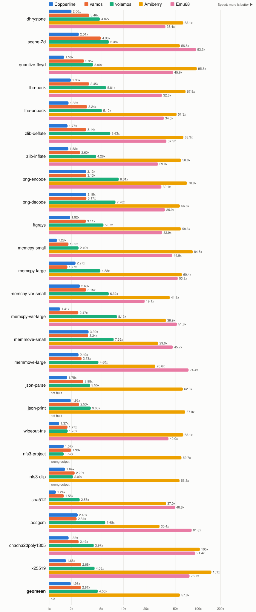

# Comparing m68k emulators

Part of the [Benchwork results](README.md); unlike the other pages, this
one measures the emulators rather than the code they run.

The benchwork-040 release binary, built with m68k-amigaos-gcc
16.2-rc25[^rc25], runs on each emulator's JIT or fastest interpreter on one
host, an AMD Ryzen AI 9 HX 370 under Linux held at its nominal 2 GHz,
except Emu68, which ran an older binary on the Raspberry Pi of a
PiStorm[^emu68]. The first column is the same binary on a 25 MHz 68040, as
measured by every other page, and each cell says how many times faster than
that 68040 the emulator ran. The geomeans leave out the two JSON
benchmarks, which Emu68's older binary lacks.

Each bar is the 68040's time divided by the emulator's, so longer is
faster. The axis is logarithmic: the emulators are up to two orders of
magnitude apart.

Same data in tabular form (time in milliseconds):

| benchmark | 25 MHz 68040 | Copperline | vamos | volamos | Amiberry | Emu68[^emu68] |
|---|---:|---:|---:|---:|---:|---:|
| dhrystone | 430 | 85.2 (5.0x) | 52.5 (8.2x) | 41.8 (10.3x) | 6.98 (61.6x) | 11.9 (36.1x) |
| scene-2d | 1007 | 178 (5.6x) | 83.4 (12.1x) | 69.6 (14.5x) | 17.5 (57.6x) | 10.9 (92.4x) |
| quantize-floyd | 665 | 169 (3.9x) | 93.0 (7.2x) | 76.1 (8.7x) | 6.63 (100.3x) | 14.3 (46.4x) |
| lha-pack | 1098 | 252 (4.4x) | 132 (8.3x) | 94.0 (11.7x) | 16.2 (67.9x) | 33.8 (32.5x) |
| lha-unpack | 292 | 75.1 (3.9x) | 37.7 (7.7x) | 35.0 (8.3x) | 5.80 (50.3x) | 8.59 (34.0x) |
| zlib-deflate | 802 | 197 (4.1x) | 109 (7.4x) | 75.9 (10.6x) | 13.0 (61.7x) | 21.4 (37.5x) |
| zlib-inflate | 230 | 52.0 (4.4x) | 35.6 (6.5x) | 23.1 (10.0x) | 3.86 (59.7x) | 7.06 (32.6x) |
| png-encode | 1254 | 173 (7.3x) | 172 (7.3x) | 54.0 (23.2x) | 17.8 (70.5x) | 40.2 (31.2x) |
| png-decode | 982 | 128 (7.7x) | 129 (7.6x) | 52.8 (18.6x) | 17.4 (56.5x) | 27.3 (36.0x) |
| ftgrays | 659 | 130 (5.1x) | 93.4 (7.1x) | 51.2 (12.9x) | 10.8 (60.9x) | 20.0 (33.0x) |
| memcpy-small | 852 | 420 (2.0x) | 207 (4.1x) | 211 (4.0x) | 9.79 (87.1x) | 19.0 (44.9x) |
| memcpy-large | 285 | 77.9 (3.7x) | 71.1 (4.0x) | 16.0 (17.7x) | 4.53 (62.9x) | 5.35 (53.2x) |
| memcpy-var-small | 523 | 84.0 (6.2x) | 71.9 (7.3x) | 30.5 (17.1x) | 12.4 (42.1x) | 26.9 (19.4x) |
| memcpy-var-large | 593 | 198 (3.0x) | 105 (5.6x) | 19.2 (30.8x) | 16.1 (36.8x) | 11.4 (51.9x) |
| memmove-small | 920 | 126 (7.3x) | 103 (8.9x) | 43.7 (21.1x) | 31.2 (29.5x) | 19.8 (46.5x) |
| memmove-large | 957 | 178 (5.4x) | 138 (6.9x) | 69.7 (13.7x) | 35.6 (26.9x) | 12.8 (74.5x) |
| json-parse | 409 | 96.4 (4.2x) | 56.4 (7.2x) | 46.3 (8.8x) | 7.36 (55.5x) |  |
| json-print | 256 | 65.4 (3.9x) | 40.5 (6.3x) | 29.7 (8.6x) | 6.41 (40.0x) |  |
| wipeout-tris | 890 | 483 (1.8x) | 187 (4.8x) | 239 (3.7x) | 212 (4.2x) | 21.8 (40.8x) |
| nfs3-project[^emu68fpu] | 1064 | 646 (1.6x) | 228 (4.7x) | 318 (3.3x) | 399 (2.7x) | 43.8 (24.3x) |
| nfs3-clip[^emu68fpu] | 943 | 500 (1.9x) | 157 (6.0x) | 224 (4.2x) | 150 (6.3x) | 27.7 (34.0x) |
| sha512 | 959 | 372 (2.6x) | 258 (3.7x) | 181 (5.3x) | 9.27 (103.5x) | 21.3 (44.9x) |
| aesgcm | 826 | 372 (2.2x) | 144 (5.7x) | 163 (5.1x) | 20.9 (39.5x) | 9.81 (84.2x) |
| chacha20poly1305 | 399 | 107 (3.7x) | 67.7 (5.9x) | 44.6 (9.0x) | 3.82 (104.4x) | 4.38 (91.1x) |
| x25519 | 546 | 136 (4.0x) | 77.1 (7.1x) | 60.5 (9.0x) | 2.92 (186.7x) | 7.13 (76.5x) |
| **GEOMEAN** | **680** | **178 (3.8x)** | **105 (6.5x)** | **68.2 (10.0x)** | **15.7 (43.2x)** | **15.5 (43.8x)** |

vamos and volamos are not Amiga emulators: they run one program on an
emulated CPU and implement the OS libraries in host code. That host code
is free in their time, which favors them in memcpy-var-small and
memcpy-var-large, whose copies go through exec's CopyMem. Copperline and
Amiberry boot AmigaOS 3.x on an emulated A4000 and emulate its chipset in
real time alongside the CPU. Emu68 emulates only the CPU, in place of the
Amiga's own, and boots AmigaOS on the Amiga's chipset.

Copperline and volamos run the CPU on the same core, m68k-rs, yet volamos
is 2.6 times as fast: Copperline runs it alongside the chipset at the clock
its governor sets, and volamos lets it run free.

Amiberry's JIT and Emu68 are within 2% of each other overall, each about
6.7 times as fast as vamos. Amiberry would lead clearly but for floating
point: since Amiberry #2619, every FPU instruction goes through a helper
that computes the 68040's status, rounding and exceptions exactly. Against
376b22c99, the Amiberry this page used before, that makes wipeout-tris 16
times slower, nfs3-project 28 times and nfs3-clip 10 to 16 times, and
vamos beats it on the first two.

## How the emulators were run

The times are host time. vamos and volamos read the host clock for the
guest's E clock. Amiberry and Copperline keep the chipset, and with it the
E clock, in real time, and give the CPU whatever host time is left; that
only holds in their fastest-possible modes. Amiberry's JIT runs in bursts
between which the E clock stands still, so a single loop can finish without
it moving: every emulator runs `benchwork-040 REPEAT 3 MINTIME 1000`, which
loops over each benchmark until a repetition lasts at least a second.

Amiberry and Copperline boot from a volume of their own rather than from
Workbench. Its startup sequence runs TinySetPatch[^tinysetpatch], which
loads MMULib's 68040.library[^mmulib]: that turns the CPU caches on and
emulates the instructions the 68040 lacks, as SetPatch does on any booted
machine. Then it runs benchwork-040 and leaves the output in a host
directory. Nothing is printed until the end, so no screen opens and the
chipset fetches no bitplanes while the benchmarks run.

Each emulator runs the 68040 on one host core. With boost, the host's clock
would depend on its temperature and on which core that is, so
`tools/bench-host-prep.sh` turns boost off first, which holds every core at
its nominal 2 GHz; on this host, boost reaches 5.2 GHz on four of its
twelve cores.

- vamos[^vamos], which emulates the CPU with Musashi: `vamos --cpu 68040
  -m 8192 -s 64`.
- volamos 0.21~pre[^volamos]: `volamos --jit --cpu 68040 --stack 65536`.
  13% slower than 0.13.0 on the same binary: its update to m68k-rs 0.15
  (sidick/volamos d8f02dd) cost 12% overall, and the one to 0.17 (55d493c)
  a further 17 to 23% on the floating-point benchmarks.
- Amiberry[^amiberry]: an A4000 with a 68040 and its FPU, 32 MB of fast
  memory, no MMU and `cpu_speed=max`, the JIT with its FPU and a 16 MB
  translation cache, and no sound.
- Copperline[^copperline]: an A4000 with a 68040 and 16 MB of fast memory,
  `jit = true` and `speed = "fastest"` from a 25 MHz floor. Its governor
  set the CPU clock between 25 and 122 MHz, 57 MHz in the median. In 13% of
  its samples the host fell behind real time, by 18% on average, so its
  times are at most a few percent shorter than they took on the host.

[^rc25]: `m68k-amigaos-gcc (AmigaDev 16.2-rc25) 16.2.1b 20261010182711`,
    with its default newlib runtime.
[^vamos]: vamos from AmigaPorts/amitools fb57469f, with machine68k 0.4.1.
[^volamos]: volamos 98b7a29, 0.21~pre with m68k-rs 0.17.0.
[^amiberry]: Amiberry d2a0c61bf, after v8.5.0.
[^copperline]: Copperline 0ca2ec17, v1.1.0.
[^tinysetpatch]: TinySetPatch from reinauer/xSysInfo, a minimal
    SetPatch under the BSD 2-clause licence.
[^mmulib]: MMULib 47.11.2 by Thomas Richter, from Aminet.
[^emu68]: Emu68 1.1.beta.2 on a classic PiStorm (PocketStorm) with a
    Raspberry Pi 4 8 GB at 1800 MHz, measured by mschulz. Unlike the other
    columns, it ran a different binary on a different host: the
    benchwork-040 of the Benchwork 2.0 release, built with 16.2-rc19, which
    has no JSON benchmarks. At 2100 MHz its geomean is 13.3 ms (51.2x).
[^emu68fpu]: Emu68's check values for nfs3-project and nfs3-clip are
    8599502a and 50ad9de3, where the 68040 and the other emulators give
    a12e9d08 and b256492e. Both kernels are floating point, so Emu68's FPU
    likely rounds differently.
