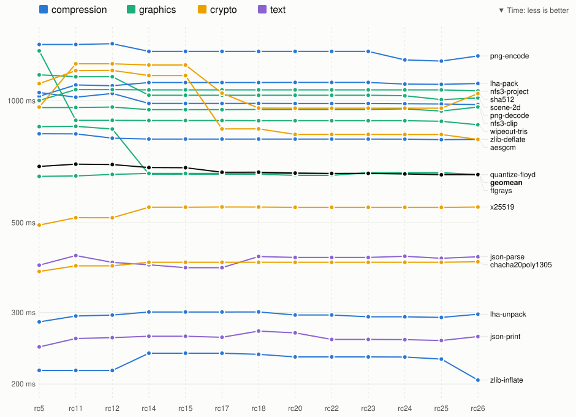
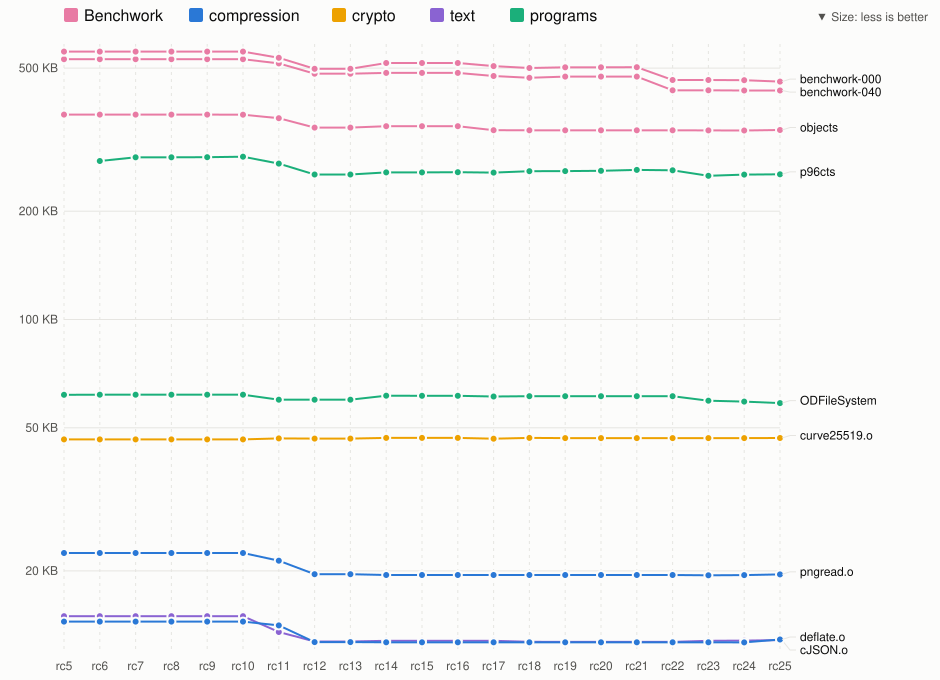
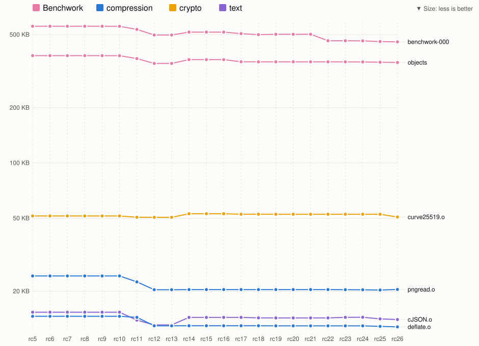

# Comparing GCC 16.2 releases

Part of the [Benchwork results](README.md); see there for how they are
measured.

benchwork-040 built with `-O2 -fomit-frame-pointer -m68040 -m68881` by each
AmigaPorts release[^releases] since rc5, the oldest one still published, and
run on a 68040; benchwork-000, `-m68000` with soft float, run on a 68000.
The notes are about the 68040 unless they say otherwise, and the tables
behind the charts are on [a page of their own](gcc-releases-raw.md):

- rc11: LRA by default, small constant-size copies inlined.
- rc12: block duplication in the reordering pass bounded, which makes the
  program 6% smaller (libpng 8%, zlib's deflate 10%): json-parse 3.8% and
  zlib-deflate 2.4% faster, png-decode 2.1% slower.
- rc14: Bebbo's code generation work (costs, dbra, inline block copies).
- rc17: GCC 16.2.1, 64-bit integer operations split into 32-bit ones.
- rc18: newlib upstream merge (memmove, and a json-parse 7% slower),
  68040 cost fix (sha512), `-m68020-60` multilibs.
- rc19: doloop loops end in `dbne`, inline 32x32->64 multiplies for
  `-m68020-60` and `-m68060`, a fix for PR 125728. rc20 generates the
  same code, and stands in for it below.
- rc21: the same code as rc20 here. Only soft-float code changes: its
  float compares give the unordered result for a NaN, and nfs3-clip on a
  68000 runs 0.16% faster with them.
- rc22: newlib without multibyte support, which makes the program 41 KB
  (8%) smaller, the `strtod()` and `sscanf()` of the JSON benchmarks no
  longer pulling in its tables, and json-print 4% faster.
- rc23: `memset()` keeps its value in a register, and fewer functions get
  a frame pointer: lha-unpack 1% faster, quantize-floyd 1.5% slower.
- rc24: png-encode 4.7% faster. Dhrystone 4% slower: newlib's `strcmp()`
  byte loop takes six instructions instead of five, its second pointer
  copied through a data register on every pass.
- rc25: from the 68020 on, byte-aligned block copies use long moves, and on
  the 68040 and 68060 a compare takes a constant that `moveq` could load as
  an immediate: memcpy-small 6% faster, scene-2d 2%, 0.6% overall. The
  newlib startup code no longer pulls in `strstr()`, or stdio when the
  program doesn't use it.
- rc26: Bebbo's table-driven cost model, tuned by CMA-ES
  (AmigaPorts/gcc#138), among other changes. The cost model makes
  zlib-inflate 11% faster and aesgcm 2.8%, but sha512 9% slower, its 64-bit
  halves moved through address registers. wipeout-tris is 1.9% faster;
  png-encode, nfs3-clip and json-print 2% to 3% slower. Overall unchanged.

## Application workloads

The charts show each benchmark's time in ms, so lower is faster, and skip
the releases in which none of their benchmarks changes by more than 1% from
the release before, but for the latest. Their vertical axes are
logarithmic, so equal slopes are equal percentages.

On a 7.09 MHz 68000, benchwork-000 is 3.1% faster than with rc5. rc14
made sha512 and aesgcm 40% slower there, which rc17's 32-bit halves of
64-bit operations take back. png-decode is 11% faster since rc14, and
png-encode 11% faster, half of it in rc24.

## Memory

The copies and Dhrystone, apart so that their large swings do not hide the
application workloads, with a geomean of their own: the inline block copies
of rc14 and the `memmove()` of rc18's newlib made memcpy-small and
memmove-large three times faster.

On the 68000 the memory group takes 17% less time than with rc5:
memmove-large 60% less since rc18 and rc19, memcpy-small 23% less and
Dhrystone 9% less since rc14, but memcpy-large 26% more since rc14.

## Code size

The size of the code (`text`) each release makes of a few programs and
objects, each built the same way in every release.

- **benchwork-040**: [Benchwork](../README.md), `-O2 -fomit-frame-pointer
  -m68040 -m68881`, linked with newlib. 18% smaller than with rc5, 96 KB:
  35 KB of it its own code, the rest newlib, 41 KB of that in rc22, which
  dropped its multibyte and locale code.
- **benchwork-000**: the same for the 68000, `-m68000`, with soft float.
  17% smaller than with rc5, but rc14 grows it 3.8%, where it costs
  benchwork-040 0.6%. rc25's newlib startup code takes 4 KB off it.
- **objects**: benchwork-040's own objects, summed, without the libraries
  they link to: what the compiler alone makes of Benchwork's sources.
  9.4% smaller than with rc5, mostly in rc11 and rc12; rc25's long-move
  copies add 1 KB back.
- **curve25519.o**: AmiSSL's [X25519](../third_party/amissl/curve25519.c),
  32x32->64 multiplies and carries over ten 26-bit limbs. Within 1% of rc5
  up to rc25; 1.5% larger with rc26.
- **pngread.o**: libpng's [decoder](../third_party/libpng/pngread.c). 11%
  smaller, almost all of it in rc11 and rc12; rc26 adds 1.5% back.
- **cJSON.o**: [cJSON](../third_party/cjson/cJSON.c), the parser and printer
  of the JSON benchmarks. 15% smaller, most of it in rc11 and rc12.
- **deflate.o**: zlib's [compressor](../third_party/zlib/deflate.c). 11%
  smaller, most of it in rc12; rc25's long-move copies add 1.9%.
- **ODFileSystem**: the [CD-ROM filesystem](https://github.com/reinauer/ODFileSystem)
  handler at v1.0.0-beta3, `make amiga AMIGA_OPT=-Os`: its normal build
  optimized for size, as its ROM build is, though the normal build isn't
  by default. 4.8% smaller, 2.8% of it in rc23, which worked on `-Os`,
  and 1.5% in rc24 and rc25; rc26 adds 0.4% back.
- **p96cts**: the [Picasso96 test suite](https://github.com/codewiz/p96cts)
  at v1.0.1, with its own `-O3 -m68020-60` and libnix. rc5 cannot build it:
  it has no libpng for libnix. 8% smaller than with rc6, after growing 3%
  up to rc10; rc23's libnix, built at `-Os`, takes 3.4%.

The same Benchwork objects built for the 68000, `-m68000`, are 8.2% smaller
than with rc5. rc14 grows them 5% (cJSON.o 10%, curve25519.o 4.6%), where
it costs the 68040's 1%, and rc26 takes 3.4% off curve25519.o.

[^releases]: The released x86_64 Linux tarballs, with their default newlib
    runtime.
