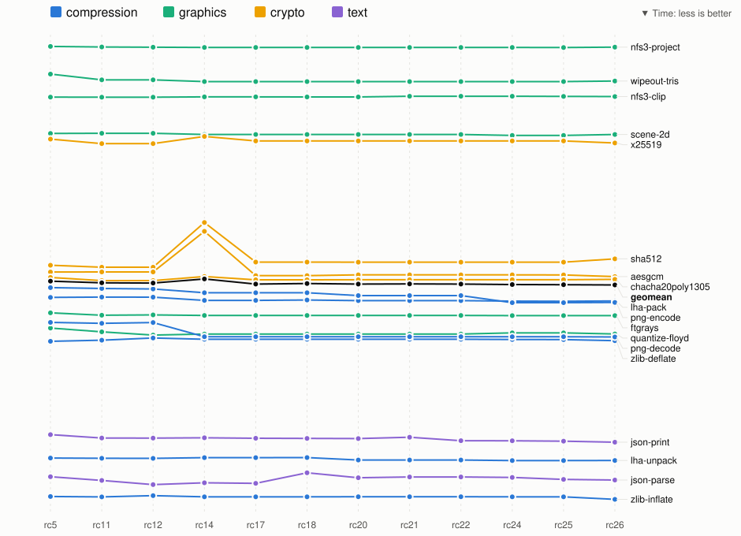
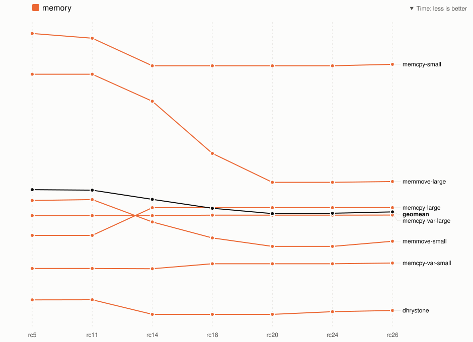

# Comparing GCC 16.2 releases

This page is part of the [Benchwork results](README.md), which describe how
the benchmarks are measured.

Benchwork was built with each AmigaPorts release[^releases] since rc5, the
oldest one still published, in two configurations: benchwork-040, with
`-O2 -fomit-frame-pointer -m68040 -m68881`, runs on a 68040, and
benchwork-000, with `-m68000` and soft float, runs on a 68000. The tables
behind the charts are on [a separate page](gcc-releases-raw.md), and the
[history](#history-of-notable-performance-changes) at the end lists the
releases that changed them.

## Application workloads

The charts plot the time of each benchmark, so lower is better. They omit
the releases in which no benchmark changed by more than 1% from the
previous release, except the latest one. The vertical axes are logarithmic,
so equal slopes are equal percentage changes.

### 68040 (FPU)

### 68000 (soft-float)

On a 68000, benchwork-000 is 3.1% faster today than with 16.2-rc5.
png-decode has been 11% faster since rc14, and png-encode is also 11%
faster, half of that from rc24.

## Memory

The copy benchmarks and Dhrystone have charts of their own, with their own
geomean, so that their large swings do not hide the application workloads.

### 68040 (FPU)

The inline block copies of rc14 and the `memmove()` of rc18's newlib made
memcpy-small and memmove-large three times faster.

### 68000 (soft-float)

The memory group takes 17% less time than with rc5. Since rc18 and rc19,
memmove-large takes 60% less time; since rc14, memcpy-small takes 23% less
and Dhrystone 9% less, but memcpy-large takes 26% more.

## Code size

The charts show the size of the code (`text`) that each release generates
for a few programs and objects, each built the same way in every release.

### Benchwork and other programs

- **benchwork-040**: [Benchwork](../README.md) built with
  `-O2 -fomit-frame-pointer -m68040 -m68881` and linked with newlib. At
  96 KB, it is 18% smaller than with rc5; 35 KB of it is Benchwork's own
  code and the rest is newlib. 41 KB of the reduction came with rc22, which
  dropped newlib's multibyte and locale code.
- **benchwork-000**: the same program built for the 68000 with `-m68000`
  and soft float. It is 17% smaller than with rc5, although rc14 made it
  3.8% larger, against 0.6% for benchwork-040. The newlib startup code of
  rc25 removed 4 KB.
- **objects**: the sum of benchwork-040's own objects, without the libraries
  they link against, so that only the compiler's output for Benchwork's
  sources counts. They are 9.4% smaller than with rc5, mostly from rc11 and
  rc12; the long-move copies of rc25 added 1 KB back.
- **curve25519.o**: AmiSSL's [X25519](../third_party/amissl/curve25519.c),
  which computes with 32x32->64 multiplies and carries over ten 26-bit
  limbs. It stayed within 1% of rc5 up to rc25, and is 1.5% larger with
  rc26.
- **pngread.o**: libpng's [decoder](../third_party/libpng/pngread.c). It is
  11% smaller, almost all of it from rc11 and rc12; rc26 added 1.5% back.
- **cJSON.o**: [cJSON](../third_party/cjson/cJSON.c), the parser and printer
  of the JSON benchmarks. It is 15% smaller, mostly from rc11 and rc12.
- **deflate.o**: zlib's [compressor](../third_party/zlib/deflate.c). It is
  11% smaller, mostly from rc12; the long-move copies of rc25 added 1.9%.
- **ODFileSystem**: the [CD-ROM filesystem](https://github.com/reinauer/ODFileSystem)
  handler at v1.0.0-beta3, built with `make amiga AMIGA_OPT=-Os`, which
  optimizes its normal build for size, as its ROM build is by default. It is
  4.8% smaller: 2.8% from rc23, which improved `-Os`, and
  1.5% from rc24 and rc25; rc26 added 0.4% back.
- **p96cts**: the [Picasso96 test suite](https://github.com/codewiz/p96cts)
  at v1.0.1, built with its own `-O3 -m68020-60` and libnix. rc5 cannot
  build it, because it has no libpng for libnix. It is 8% smaller than with
  rc6, after growing 3% up to rc10; 3.4% of the reduction comes from the
  libnix of rc23, which is built with `-Os`.

### 68000 (soft-float)

The same Benchwork objects built for the 68000 with `-m68000` are 8.2%
smaller than with rc5. rc14 made them 5% larger (cJSON.o 10%,
curve25519.o 4.6%), against 1% for the 68040 build, and rc26 reduced
curve25519.o by 3.4%.

## History of notable performance changes

On the 68040 unless otherwise noted:

- rc11: LRA is the default register allocator, and small constant-size
  copies are inlined.
- rc12: block duplication in the reordering pass is bounded, which makes the
  program 6% smaller (libpng 8%, zlib's deflate 10%). json-parse is 3.8%
  and zlib-deflate 2.4% faster, and png-decode 2.1% slower.
- rc14: Bebbo's code generation work (costs, dbra, inline block copies).
- rc17: GCC 16.2.1, and 64-bit integer operations split into 32-bit ones.
- rc18: a merge of upstream newlib, with a new `memmove()` and a json-parse
  7% slower; a 68040 cost fix for sha512; and the `-m68020-60` multilibs.
- rc19: doloop loops end in `dbne`, `-m68020-60` and `-m68060` inline
  32x32->64 multiplies, and PR 125728 is fixed. rc20 generates the same
  code, and stands in for rc19 in the charts.
- rc21: the same code as rc20 on the 68040. Only soft-float code changes:
  its float comparisons give the unordered result for a NaN, which makes
  nfs3-clip 0.16% faster on a 68000.
- rc22: newlib is built without multibyte support, which makes the program
  41 KB (8%) smaller, because `strtod()` and `sscanf()` in the JSON
  benchmarks no longer pull in its tables; json-print is 4% faster.
- rc23: `memset()` keeps its value in a register, and fewer functions get a
  frame pointer. lha-unpack is 1% faster, and quantize-floyd 1.5% slower.
- rc24: png-encode is 4.7% faster. Dhrystone is 4% slower, because the
  byte loop of newlib's `strcmp()` takes six instructions instead of five:
  it copies its second pointer through a data register on every iteration.
- rc25: from the 68020 on, byte-aligned block copies use long moves, and on
  the 68040 and 68060 a comparison takes an immediate operand where `moveq`
  could load the constant. memcpy-small is 6% faster, scene-2d 2%, and the
  geomean 0.6%. The newlib startup code no longer pulls in `strstr()`, nor
  stdio when the program does not use it.
- rc26: Bebbo's table-driven cost model, tuned with CMA-ES
  (AmigaPorts/gcc#138), among other changes. The cost model makes
  zlib-inflate 11% and aesgcm 2.8% faster, but sha512 9% slower, because
  its 64-bit halves move through address registers. wipeout-tris is 1.9%
  faster, and png-encode, nfs3-clip and json-print 2% to 3% slower. The
  geomean is unchanged.

[^releases]: The released x86_64 Linux tarballs, with their default newlib
    runtime.
