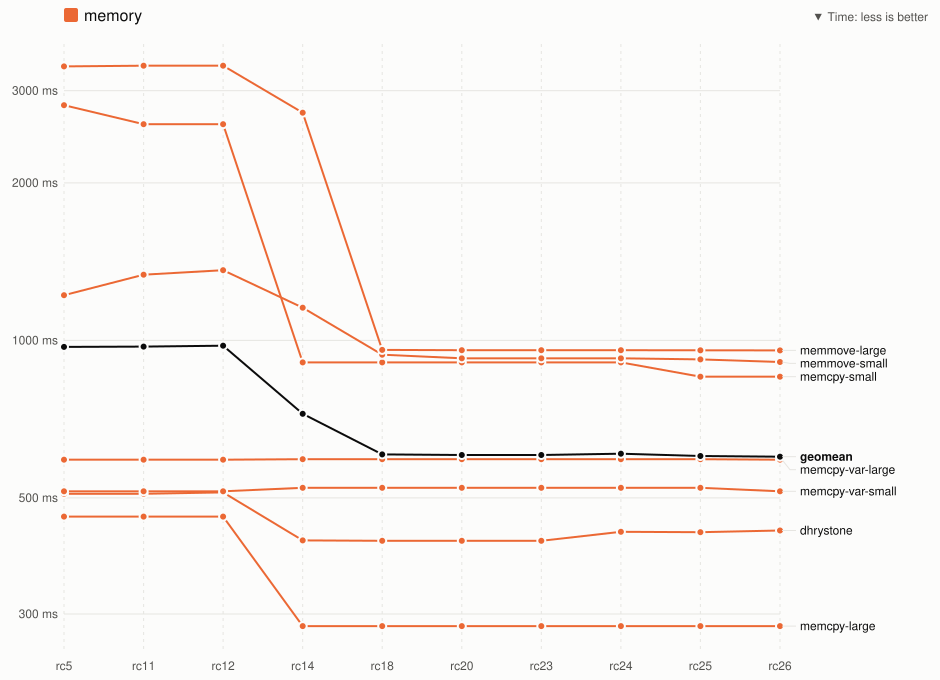

# Comparing GCC 16.2 releases

Part of the [Benchwork results](README.md); see there for how they are
measured.

benchwork-040 built with `-O2 -fomit-frame-pointer -m68040 -m68881` by each
AmigaPorts release[^releases] since rc5, the oldest one still published:

- rc11: LRA by default, small constant-size copies inlined.
- rc12: block duplication in the reordering pass bounded, which makes the
  program 6% smaller (libpng 8%, zlib's deflate 10%): json-parse 3.8% and
  zlib-deflate 2.4% faster, png-decode 2.1% slower.
- rc14: Bebbo's code generation work (costs, dbra, inline block copies).
- rc17: GCC 16.2.1, 64-bit integer operations split into 32-bit ones.
- rc18: newlib upstream merge (memmove, and a json-parse 7% slower),
  68040 cost fix (sha512), `-m68020-60` multilibs.
- rc19: doloop loops end in `dbne`, inline 32x32->64 multiplies for
  `-m68020-60` and `-m68060`, a fix for PR 125728. rc20 generates the
  same code, and stands in for it below.
- rc21: the same code as rc20 here. Only soft-float code changes: its
  float compares give the unordered result for a NaN, and nfs3-clip on a
  68000 runs 0.16% faster with them.
- rc22: newlib without multibyte support, which makes the program 41 KB
  (8%) smaller, the `strtod()` and `sscanf()` of the JSON benchmarks no
  longer pulling in its tables, and json-print 4% faster.
- rc23: `memset()` keeps its value in a register, and fewer functions get
  a frame pointer: lha-unpack 1% faster, quantize-floyd 1.5% slower.
- rc24: png-encode 4.7% faster. Dhrystone 4% slower: newlib's `strcmp()`
  byte loop takes six instructions instead of five, its second pointer
  copied through a data register on every pass.
- rc25: from the 68020 on, byte-aligned block copies use long moves, and on
  the 68040 and 68060 a compare takes a constant that `moveq` could load as
  an immediate: memcpy-small 6% faster, scene-2d 2%, 0.6% overall. The
  newlib startup code no longer pulls in `strstr()`, or stdio when the
  program doesn't use it.

## Application workloads

The charts show each benchmark's time in ms, so lower is faster, and skip
the releases in which none of their benchmarks changes by more than 1% from
the release before, but for the latest. Their vertical axes are
logarithmic, so equal slopes are equal percentages.

| benchmark | rc5 | rc11 | rc12 | rc14 | rc17 | rc18 | rc20 | rc22 | rc23 | rc24 | rc25 |
|---|---:|---:|---:|---:|---:|---:|---:|---:|---:|---:|---:|
| scene-2d | 1159 | 1147 (-1.08%) | 1147 (-1.04%) | 1032 (-10.96%) | 1032 (-10.96%) | 1032 (-10.96%) | 1032 (-10.96%) | 1032 (-10.96%) | 1032 (-10.96%) | 1029 (-11.20%) | **1007 (-13.16%)** |
| quantize-floyd | 863 | 865 (+0.19%) | 852 (-1.35%) | 659 (-23.70%) | 659 (-23.70%) | 659 (-23.70%) | **655 (-24.20%)** | **655 (-24.20%)** | 665 (-22.99%) | 665 (-22.98%) | 665 (-22.98%) |
| lha-pack | **1026** | 1095 (+6.69%) | 1089 (+6.17%) | 1110 (+8.14%) | 1110 (+8.14%) | 1110 (+8.14%) | 1110 (+8.19%) | 1110 (+8.19%) | 1110 (+8.19%) | 1100 (+7.20%) | 1099 (+7.06%) |
| lha-unpack | **285** | 294 (+3.40%) | 296 (+3.96%) | 301 (+5.77%) | 301 (+5.77%) | 301 (+5.83%) | 296 (+3.99%) | 296 (+3.99%) | 293 (+2.95%) | 293 (+2.94%) | 292 (+2.59%) |
| zlib-deflate | 829 | 829 (-0.05%) | 809 (-2.48%) | 804 (-3.00%) | 804 (-3.00%) | 804 (-3.00%) | 804 (-3.00%) | 804 (-3.00%) | 804 (-3.00%) | 804 (-3.00%) | **802 (-3.29%)** |
| zlib-inflate | **216** | **216 (-0.04%)** | **216 (-0.03%)** | 238 (+10.27%) | 238 (+10.27%) | 237 (+9.56%) | 233 (+7.98%) | 233 (+7.98%) | 233 (+7.98%) | 233 (+7.90%) | 230 (+6.62%) |
| png-encode | 1378 | 1378 (-0.01%) | 1383 (+0.39%) | 1324 (-3.87%) | 1324 (-3.87%) | 1324 (-3.87%) | 1324 (-3.88%) | 1324 (-3.88%) | 1324 (-3.88%) | 1262 (-8.42%) | **1254 (-9.02%)** |
| png-decode | 1048 | 1021 (-2.61%) | 1043 (-0.53%) | 985 (-6.01%) | 985 (-6.01%) | 985 (-6.00%) | 985 (-6.07%) | 985 (-6.07%) | 985 (-6.07%) | 983 (-6.19%) | **982 (-6.32%)** |
| ftgrays | **651** | 653 (+0.26%) | 658 (+1.12%) | 662 (+1.68%) | 662 (+1.68%) | 662 (+1.69%) | 661 (+1.54%) | 661 (+1.54%) | 661 (+1.54%) | 661 (+1.52%) | 659 (+1.30%) |
| json-parse | 393 | 415 (+5.62%) | 399 (+1.59%) | 394 (+0.22%) | **387 (-1.43%)** | 413 (+5.04%) | 411 (+4.48%) | 411 (+4.48%) | 411 (+4.48%) | 413 (+5.17%) | 409 (+3.98%) |
| json-print | **247** | 259 (+4.88%) | 260 (+5.39%) | 263 (+6.25%) | 261 (+5.62%) | 270 (+9.40%) | 268 (+8.29%) | 258 (+4.32%) | 258 (+4.32%) | 258 (+4.24%) | 256 (+3.68%) |
| wipeout-tris | 1329 | 895 (-32.62%) | 895 (-32.62%) | 894 (-32.70%) | 894 (-32.70%) | 893 (-32.77%) | 893 (-32.77%) | 893 (-32.77%) | 893 (-32.77%) | 893 (-32.77%) | **890 (-33.01%)** |
| nfs3-project | **1002** | 1066 (+6.39%) | 1066 (+6.39%) | 1064 (+6.19%) | 1064 (+6.19%) | 1064 (+6.19%) | 1064 (+6.19%) | 1064 (+6.19%) | 1064 (+6.19%) | 1064 (+6.19%) | 1064 (+6.19%) |
| nfs3-clip | 962 | 963 (+0.03%) | 965 (+0.29%) | 951 (-1.17%) | 951 (-1.17%) | 952 (-1.10%) | 952 (-1.10%) | 952 (-1.10%) | 952 (-1.10%) | 955 (-0.78%) | **943 (-1.98%)** |
| sha512 | 957 | 1234 (+29.03%) | 1226 (+28.13%) | 1220 (+27.49%) | 1038 (+8.54%) | 960 (+0.32%) | **953 (-0.40%)** | **953 (-0.40%)** | 959 (+0.25%) | 959 (+0.25%) | **953 (-0.40%)** |
| aesgcm | 1103 | 1187 (+7.68%) | 1189 (+7.80%) | 1154 (+4.70%) | 852 (-22.69%) | 853 (-22.66%) | **826 (-25.07%)** | **826 (-25.07%)** | **826 (-25.07%)** | **826 (-25.10%)** | **826 (-25.10%)** |
| chacha20poly1305 | **379** | 392 (+3.26%) | 392 (+3.26%) | 399 (+5.34%) | 399 (+5.34%) | 399 (+5.34%) | 399 (+5.34%) | 399 (+5.34%) | 399 (+5.34%) | 399 (+5.34%) | 399 (+5.34%) |
| x25519 | **494** | 515 (+4.25%) | 514 (+4.21%) | 546 (+10.64%) | 547 (+10.81%) | 547 (+10.76%) | 546 (+10.56%) | 546 (+10.56%) | 546 (+10.56%) | 546 (+10.56%) | 546 (+10.56%) |
| **GEOMEAN** | **689** | **698 (+1.32%)** | **696 (+1.08%)** | **684 (-0.62%)** | **666 (-3.27%)** | **667 (-3.19%)** | **663 (-3.71%)** | **662 (-3.91%)** | **662 (-3.84%)** | **660 (-4.13%)** | **657 (-4.62%)** |
| **CODE SIZE** | 542016 | 527612 (-2.66%) | 493700 (-8.91%) | 496452 (-8.41%) | 486584 (-10.23%) | 481124 (-11.23%) | 484796 (-10.56%) | 444016 (-18.08%) | 443932 (-18.10%) | 443508 (-18.17%) | 443472 (-18.18%) |

## Memory

The copies and Dhrystone, apart so that their large swings do not hide the
application workloads, with a geomean of their own: the inline block copies
of rc14 and the `memmove()` of rc18's newlib made memcpy-small and
memmove-large three times faster.

| benchmark | rc5 | rc11 | rc12 | rc14 | rc18 | rc20 | rc23 | rc24 | rc25 |
|---|---:|---:|---:|---:|---:|---:|---:|---:|---:|
| dhrystone | 509 | 509 | 512 (+0.63%) | 415 (-18.54%) | **414 (-18.70%)** | **414 (-18.70%)** | **414 (-18.70%)** | 431 (-15.40%) | 430 (-15.56%) |
| memcpy-small | 2815 | 2589 (-8.02%) | 2589 (-8.02%) | 908 (-67.75%) | 908 (-67.75%) | 908 (-67.75%) | 908 (-67.75%) | 908 (-67.75%) | **852 (-69.71%)** |
| memcpy-large | 461 | 461 | 461 | **285 (-38.23%)** | **285 (-38.23%)** | **285 (-38.23%)** | **285 (-38.23%)** | **285 (-38.23%)** | **285 (-38.23%)** |
| memcpy-var-small | **515** | **515** | **515** | 523 (+1.54%) | 523 (+1.54%) | 523 (+1.54%) | 523 (+1.54%) | 523 (+1.54%) | 523 (+1.54%) |
| memcpy-var-large | **592** | **592** | **592** | 593 (+0.19%) | 593 (+0.19%) | 593 (+0.19%) | 593 (+0.19%) | 593 (+0.19%) | 593 (+0.19%) |
| memmove-small | 1220 | 1335 (+9.44%) | 1362 (+11.65%) | 1155 (-5.35%) | 939 (-23.03%) | 924 (-24.24%) | 924 (-24.24%) | 924 (-24.24%) | **920 (-24.61%)** |
| memmove-large | 3339 | 3349 (+0.32%) | 3349 (+0.32%) | 2723 (-18.44%) | 959 (-71.27%) | 958 (-71.31%) | 958 (-71.31%) | 958 (-71.31%) | **957 (-71.33%)** |
| **GEOMEAN** | **972** | **973 (+0.14%)** | **977 (+0.52%)** | **724 (-25.49%)** | **606 (-37.70%)** | **604 (-37.85%)** | **604 (-37.85%)** | **607 (-37.50%)** | **601 (-38.12%)** |

## Code size

The size of the code (`text`) each release makes of a few programs and
objects, each built the same way in every release.

| bytes | rc5 | rc6 | rc11 | rc12 | rc14 | rc17 | rc22 | rc23 | rc24 | rc25 |
|---|---:|---:|---:|---:|---:|---:|---:|---:|---:|---:|
| benchwork-040 | 542016 | 542016 | 527612 (-2.66%) | 493700 (-8.91%) | 496452 (-8.41%) | 486584 (-10.23%) | 444016 (-18.08%) | 443932 (-18.10%) | 443508 (-18.17%) | 443472 (-18.18%) |
| benchwork-000 | 568776 | 568776 | 546860 (-3.85%) | 509680 (-10.39%) | 528716 (-7.04%) | 518552 (-8.83%) | 474268 (-16.62%) | 474232 (-16.62%) | 473792 (-16.70%) | 469544 (-17.45%) |
| objects | 379952 | 379952 | 371368 (-2.26%) | 349740 (-7.95%) | 352908 (-7.12%) | 343952 (-9.47%) | 343628 (-9.56%) | 343544 (-9.58%) | 343288 (-9.65%) | 344372 (-9.36%) |
| curve25519.o | 47508 | 47508 | 47812 (+0.64%) | 47756 (+0.52%) | 47976 (+0.99%) | 47736 (+0.48%) | 47932 (+0.89%) | 47932 (+0.89%) | 47932 (+0.89%) | 47940 (+0.91%) |
| pngread.o | 22972 | 22972 | 21864 (-4.82%) | 20052 (-12.71%) | 19948 (-13.16%) | 19948 (-13.16%) | 19952 (-13.15%) | 19912 (-13.32%) | 19932 (-13.23%) | 20032 (-12.80%) |
| cJSON.o | 15328 | 15328 | 13852 (-9.63%) | 13032 (-14.98%) | 13092 (-14.59%) | 13092 (-14.59%) | 13000 (-15.19%) | 13088 (-14.61%) | 13112 (-14.46%) | 13152 (-14.20%) |
| deflate.o | 14804 | 14804 | 14448 (-2.40%) | 12984 (-12.29%) | 12964 (-12.43%) | 12964 (-12.43%) | 12964 (-12.43%) | 12964 (-12.43%) | 12960 (-12.46%) | 13200 (-10.83%) |
| ODFileSystem | 63240 | 63248 (+0.01%) | 61288 (-3.09%) | 61288 (-3.09%) | 62852 (-0.61%) | 62548 (-1.09%) | 62644 (-0.94%) | 60888 (-3.72%) | 60544 (-4.26%) | 59956 (-5.19%) |
| p96cts |  | 282380 | 277760 (-1.64%) | 258980 (-8.29%) | 262544 (-7.02%) | 262144 (-7.17%) | 266064 (-5.78%) | 256948 (-9.01%) | 258864 (-8.33%) | 259364 (-8.15%) |

- **benchwork-040**: [Benchwork](../README.md), `-O2 -fomit-frame-pointer
  -m68040 -m68881`, linked with newlib. 18% smaller than with rc5, 96 KB:
  35 KB of it its own code, the rest newlib, 41 KB of that in rc22, which
  dropped its multibyte and locale code.
- **benchwork-000**: the same for the 68000, `-m68000`, with soft float.
  17% smaller than with rc5, but rc14 grows it 3.8%, where it costs
  benchwork-040 0.6%. rc25's newlib startup code takes 4 KB off it.
- **objects**: benchwork-040's own objects, summed, without the libraries
  they link to: what the compiler alone makes of Benchwork's sources.
  9.4% smaller than with rc5, mostly in rc11 and rc12; rc25's long-move
  copies add 1 KB back.
- **curve25519.o**: AmiSSL's [X25519](../third_party/amissl/curve25519.c),
  32x32->64 multiplies and carries over ten 26-bit limbs. Within 1% of rc5
  in every release.
- **pngread.o**: libpng's [decoder](../third_party/libpng/pngread.c). 13%
  smaller, almost all of it in rc11 and rc12.
- **cJSON.o**: [cJSON](../third_party/cjson/cJSON.c), the parser and printer
  of the JSON benchmarks. 14% smaller, all of it in rc11 and rc12.
- **deflate.o**: zlib's [compressor](../third_party/zlib/deflate.c). 11%
  smaller, most of it in rc12; rc25's long-move copies add 1.9%.
- **ODFileSystem**: the [CD-ROM filesystem](https://github.com/reinauer/ODFileSystem)
  handler at v1.0.0-beta3, `make amiga AMIGA_OPT=-Os`: its normal build
  optimized for size, as its ROM build is, though the normal build isn't
  by default. 5.2% smaller, 2.8% of it in rc23, which worked on `-Os`,
  and 1.5% in rc24 and rc25.
- **p96cts**: the [Picasso96 test suite](https://github.com/codewiz/p96cts)
  at v1.0.1, with its own `-O3 -m68020-60` and libnix. rc5 cannot build it:
  it has no libpng for libnix. 8% smaller than with rc6, after growing 3%
  up to rc10; rc23's libnix, built at `-Os`, takes 3.4%.

[^releases]: The released x86_64 Linux tarballs, with their default newlib
    runtime.
