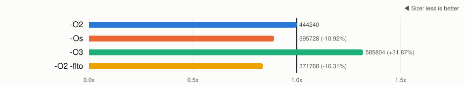

# Comparing GCC optimization levels

Part of the [Benchwork results](README.md); see there for how they are
measured.

benchwork built with m68k-amigaos-gcc 16.2-rc25[^rc25] and
`-fomit-frame-pointer -m68030 -m68881` at each level, run on a 68030 with
its 256-byte instruction cache modeled[^cache].

## Speed relative to -O2

Each bar is `-O2`'s time divided by the build's, so longer is faster;
`-O2` itself is the line at 1.0.

| benchmark | -O2 | -Os | -O3 | -O2 -flto |
|---|---:|---:|---:|---:|
| dhrystone[^dhry-lto] | 1666 | 2340 (+40.49%) | **1648 (-1.10%)** | 1664 (-0.14%) |
| scene-2d | 5177 | 8538 (+64.90%) | **3645 (-29.60%)** | 5152 (-0.50%) |
| quantize-floyd | 2410 | 2708 (+12.36%) | **2378 (-1.33%)** | 2430 (+0.83%) |
| lha-pack | 4009 | 4349 (+8.47%) | 4033 (+0.59%) | **3686 (-8.07%)** |
| lha-unpack | 1096 | 1141 (+4.17%) | 1097 (+0.09%) | **933 (-14.86%)** |
| zlib-deflate | 2980 | 3311 (+11.08%) | **2912 (-2.31%)** | 2986 (+0.19%) |
| zlib-inflate | 804 | **784 (-2.54%)** | 829 (+3.01%) | 823 (+2.33%) |
| png-encode | 4207 | 5040 (+19.80%) | 4233 (+0.61%) | **4029 (-4.24%)** |
| png-decode | 3106 | 3637 (+17.09%) | **2947 (-5.12%)** | 3070 (-1.16%) |
| ftgrays | 2627 | 2750 (+4.66%) | 2598 (-1.12%) | **2556 (-2.73%)** |
| memcpy-small | **5384** | 10531 (+95.61%) | **5384** | 5389 (+0.10%) |
| memcpy-large | **1765** | 2238 (+26.77%) | **1765** | 1776 (+0.59%) |
| memcpy-var-small | 2133 | **2106 (-1.28%)** | 2117 (-0.78%) | 2166 (+1.55%) |
| memcpy-var-large | 2900 | 2889 (-0.40%) | **2882 (-0.65%)** | 2903 (+0.09%) |
| memmove-small | **3036** | 3056 (+0.65%) | 3048 (+0.40%) | **3036** |
| memmove-large | **3857** | 3863 (+0.15%) | 3859 (+0.05%) | 3861 (+0.12%) |
| json-parse | **1031** | 1056 (+2.36%) | 1461 (+41.71%) | **1031 (-0.02%)** |
| json-print | 948 | 978 (+3.10%) | 951 (+0.33%) | **943 (-0.52%)** |
| wipeout-tris | 3802 | 5279 (+38.82%) | 3947 (+3.80%) | **3248 (-14.57%)** |
| nfs3-project | 4310 | 9580 (+122.27%) | **3414 (-20.79%)** | 3416 (-20.74%) |
| nfs3-clip | 3303 | 8573 (+159.56%) | 3199 (-3.14%) | **3190 (-3.42%)** |
| sha512 | 4727 | 4716 (-0.23%) | **4695 (-0.66%)** | 4724 (-0.05%) |
| aesgcm | 3421 | 3523 (+2.98%) | **3395 (-0.78%)** | 3423 (+0.04%) |
| chacha20poly1305 | 1797 | 1882 (+4.74%) | **1689 (-6.04%)** | 1799 (+0.12%) |
| x25519 | **2450** | 2754 (+12.41%) | 2487 (+1.52%) | 2455 (+0.21%) |
| **GEOMEAN** | **2580** | **3122 (+21.00%)** | **2542 (-1.46%)** | **2508 (-2.78%)** |
| **CODE SIZE** | 444240 | 395728 (-10.92%) | 585804 (+31.87%) | 371768 (-16.31%) |

`-Os` calls `memcpy()` and `memset()` for constant-size copies and keeps
the NFS3 kernels' `GuardedFloatMath` operations out of line, which more
than doubles their time. `-O3` loses up to 3.8% where its larger code fits
the cache worse (zlib-inflate, wipeout), but wins overall. LTO helps where a
hot loop calls into another file (LHa, wipeout, NFS3, png-encode), beats
`-O3` overall, and cuts the code by a sixth.

## Code size relative to -O2

[^rc25]: `m68k-amigaos-gcc (AmigaDev 16.2-rc25) 16.2.1b 20261010182711`,
    with its default newlib runtime.
[^cache]: volamos `--cache`: a direct-mapped instruction cache, so a miss
    costs a memory fetch. It does not model the data cache or bus wait
    states, nor yet the 68040, so the other pages run without it.
[^dhry-lto]: Dhrystone splits its procedures between dhry_1.c and
    dhry_2.c so that the compiler cannot inline across them, so the two
    files are built without LTO even in the LTO build.
