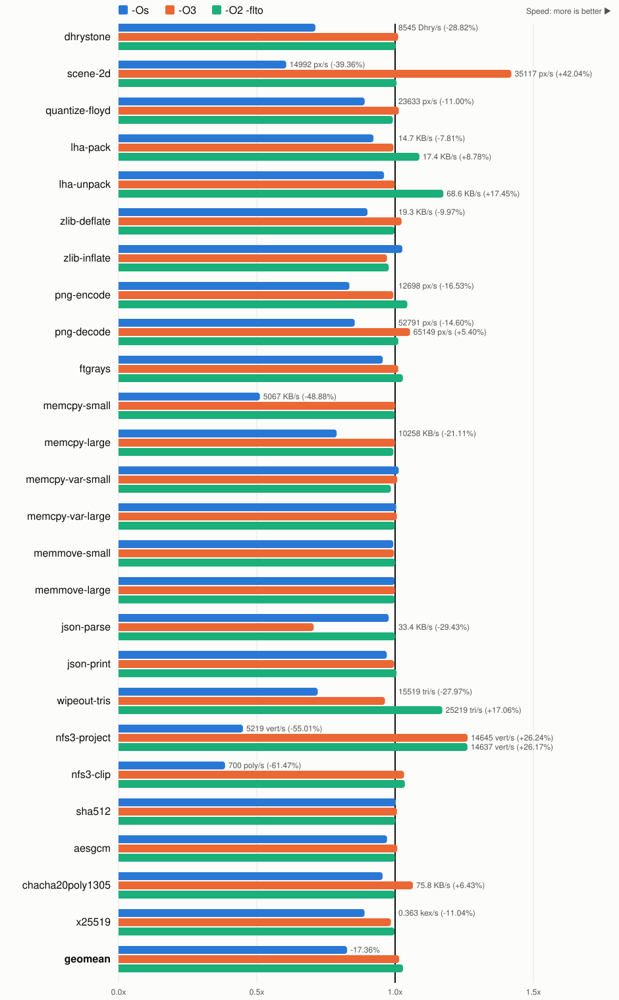

# Comparing GCC optimization levels

Part of the [Benchwork results](README.md); see there for how they are
measured.

benchwork built with m68k-amigaos-gcc 16.2-rc26[^rc26] and
`-fomit-frame-pointer -m68030 -m68881` at each level, run on a 68030 with
its 256-byte instruction cache modeled[^cache].

## Speed relative to -O2

Each bar is `-O2`'s time divided by the build's, so longer is faster;
`-O2` itself is the line at 1.0.

| benchmark | -O2 | -Os | -O3 | -O2 -flto |
|---|---:|---:|---:|---:|
| dhrystone[^dhry-lto] | 1674 | 2348 (+40.29%) | **1662 (-0.72%)** | 1678 (+0.24%) |
| scene-2d | 5266 | 9062 (+72.09%) | **3917 (-25.61%)** | 5246 (-0.39%) |
| quantize-floyd | 2315 | 6079 (+162.61%) | **2235 (-3.46%)** | 2312 (-0.15%) |
| lha-pack | 3960 | 4361 (+10.11%) | 3973 (+0.33%) | **3589 (-9.38%)** |
| lha-unpack | 1086 | 1134 (+4.39%) | 1085 (-0.11%) | **922 (-15.06%)** |
| zlib-deflate | 3008 | 3312 (+10.12%) | **2925 (-2.77%)** | 3016 (+0.26%) |
| zlib-inflate | **778** | 839 (+7.90%) | 791 (+1.70%) | 809 (+4.02%) |
| png-encode | 4234 | 4953 (+16.99%) | **4225 (-0.20%)** | 4253 (+0.47%) |
| png-decode | 3078 | 3612 (+17.36%) | **2991 (-2.81%)** | 3078 (+0.01%) |
| ftgrays | 2605 | 2764 (+6.09%) | 2573 (-1.23%) | **2535 (-2.68%)** |
| memcpy-small | **5384** | 10857 (+101.67%) | **5384** | 5389 (+0.10%) |
| memcpy-large | **1765** | 2242 (+27.03%) | **1765** | 1776 (+0.59%) |
| memcpy-var-small | 2173 | 2106 (-3.08%) | **2032 (-6.49%)** | 2128 (-2.05%) |
| memcpy-var-large | **2878** | 2889 (+0.38%) | 2886 (+0.30%) | 2879 (+0.04%) |
| memmove-small | **3142** | 3176 (+1.08%) | 3148 (+0.18%) | **3142 (+0.02%)** |
| memmove-large | 4016 | 4018 (+0.05%) | **4013 (-0.08%)** | 4016 (-0.01%) |
| json-parse | 1041 | 1070 (+2.75%) | **1001 (-3.84%)** | 1040 (-0.10%) |
| json-print | **966** | 990 (+2.50%) | 973 (+0.70%) | 971 (+0.49%) |
| wipeout-tris | 3838 | 5609 (+46.14%) | 4024 (+4.84%) | **3299 (-14.05%)** |
| nfs3-project | 4318 | 9860 (+128.35%) | **3414 (-20.94%)** | 3438 (-20.38%) |
| nfs3-clip | 3294 | 9013 (+173.62%) | 3259 (-1.06%) | **3202 (-2.78%)** |
| sha512 | 4538 | 4914 (+8.31%) | **4512 (-0.57%)** | 4528 (-0.22%) |
| aesgcm | 3303 | 3778 (+14.37%) | **3289 (-0.45%)** | 3312 (+0.26%) |
| chacha20poly1305 | 1790 | 1884 (+5.27%) | **1673 (-6.50%)** | 1800 (+0.58%) |
| x25519 | **2405** | 2895 (+20.38%) | 2433 (+1.16%) | 2408 (+0.12%) |
| **GEOMEAN** | **2575** | **3296 (+28.01%)** | **2499 (-2.95%)** | **2508 (-2.58%)** |
| **CODE SIZE** | 441352 | 394388 (-10.64%) | 579408 (+31.28%) | 368520 (-16.50%) |

`-Os` calls `memcpy()` and `memset()` for constant-size copies and keeps
the NFS3 kernels' `GuardedFloatMath` operations out of line, which more
than doubles their time. `-O3` loses up to 4.8% where its larger code fits
the cache worse (wipeout, zlib-inflate), but wins overall. LTO helps where a
hot loop calls into another file (LHa, wipeout, NFS3, ftgrays), comes within
0.4% of `-O3` overall, and cuts the code by a sixth.

## Code size relative to -O2

[^rc26]: `m68k-amigaos-gcc (AmigaDev 16.2-rc26) 16.2.1b 20261010182711`,
    with its default newlib runtime.
[^cache]: volamos `--cache`: a direct-mapped instruction cache, so a miss
    costs a memory fetch. It does not model the data cache or bus wait
    states, nor yet the 68040, so the other pages run without it.
[^dhry-lto]: Dhrystone splits its procedures between dhry_1.c and
    dhry_2.c so that the compiler cannot inline across them, so the two
    files are built without LTO even in the LTO build.
