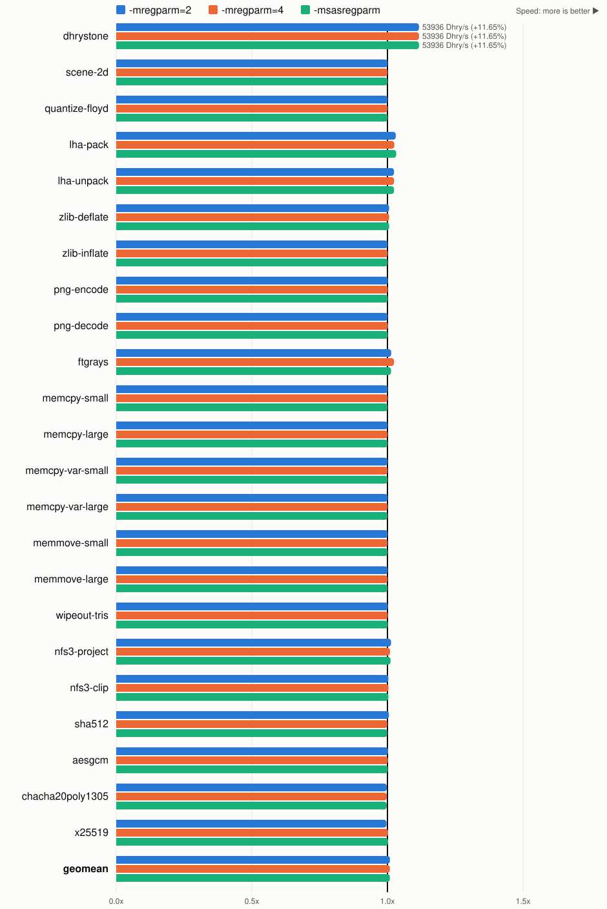

# GCC register arguments

Part of the [Benchwork results](README.md); see there for how they are
measured.

benchwork-040 built with m68k-amigaos-gcc 16.2-rc21[^rc21] and
`-O2 -fomit-frame-pointer -m68040 -m68881`, with and without
`-mregparm`[^regparm], on the 68040[^volamos].

Passing arguments in registers makes the code 3% smaller and Benchwork 1%
faster: call-heavy code gains most (Dhrystone 10%, LHa 3 to 4%, ftgrays 1
to 2%), and no benchmark loses more than 1% (png-encode). Allowing four register
arguments instead of two changes little, and so does `-msasregparm`, which
puts a third integer or pointer argument on the stack instead of in a
register of the other kind.

Each bar is the stack-argument build's time divided by the build's, so
longer is faster; stack arguments are the line at 1.0.

| benchmark | stack args | -mregparm=2 | -mregparm=4 | -msasregparm |
|---|---:|---:|---:|---:|
| dhrystone | 414 | **371 (-10.43%)** | **371 (-10.43%)** | **371 (-10.43%)** |
| scene-2d | **1032** | **1032** | **1032** | **1032** |
| quantize-floyd | **659** | **659** | **659** | **659** |
| lha-pack | 1110 | 1077 (-2.94%) | 1078 (-2.87%) | **1074 (-3.25%)** |
| lha-unpack | 301 | **289 (-4.03%)** | **289 (-4.03%)** | **289 (-4.03%)** |
| zlib-deflate | 804 | **802 (-0.28%)** | **802 (-0.28%)** | **802 (-0.28%)** |
| zlib-inflate | **237** | **237 (-0.01%)** | **237 (-0.05%)** | **237 (-0.01%)** |
| png-encode | **1324** | 1338 (+1.02%) | 1338 (+1.03%) | 1338 (+1.03%) |
| png-decode | 985 | 986 (+0.10%) | **984 (-0.16%)** | **984 (-0.09%)** |
| ftgrays | 662 | 653 (-1.35%) | **646 (-2.33%)** | 653 (-1.31%) |
| memcpy-small | **908** | **908** | **908** | **908** |
| memcpy-large | **285** | **285** | **285** | **285** |
| memcpy-var-small | **523** | **523** | **523** | **523** |
| memcpy-var-large | **593** | **593** | **593** | **593** |
| memmove-small | **939** | **939** | **939** | **939** |
| memmove-large | **959** | **959** | **959** | **959** |
| wipeout-tris | 893 | **892 (-0.10%)** | **892 (-0.10%)** | **892 (-0.10%)** |
| nfs3-project | 1064 | **1050 (-1.32%)** | 1054 (-0.94%) | 1052 (-1.13%) |
| nfs3-clip | 952 | **948 (-0.37%)** | **948 (-0.37%)** | **948 (-0.37%)** |
| sha512 | 960 | 960 (+0.06%) | **954 (-0.55%)** | **954 (-0.55%)** |
| aesgcm | 853 | **847 (-0.62%)** | 848 (-0.54%) | 848 (-0.52%) |
| chacha20poly1305 | **399** | 400 (+0.27%) | 400 (+0.27%) | 400 (+0.27%) |
| x25519 | 547 | 549 (+0.39%) | **546 (-0.18%)** | **546 (-0.14%)** |
| **GEOMEAN** | **687** | **681 (-0.88%)** | **681 (-0.97%)** | **681 (-0.94%)** |
| **CODE SIZE** | 405208 | 393492 (-2.89%) | 392040 (-3.25%) | 394264 (-2.70%) |

[^volamos]: `volamos --clock-mhz 25 --cpu 68040 --fpu <binary> REPEAT 2`,
    each repetition looping for at least a second (`MINTIME`'s default).
    The emulated time is derived from the CPU's cycle count at 25 MHz;
    native library calls cost no cycles.
[^rc21]: `m68k-amigaos-gcc (AmigaDev 16.2-rc21) 16.2.1b 20261010182711`,
    with its default newlib runtime.
[^regparm]: The whole program is built with `-mregparm`; newlib, which
    is not, keeps stack arguments because its headers declare its
    functions `__stdargs`.
