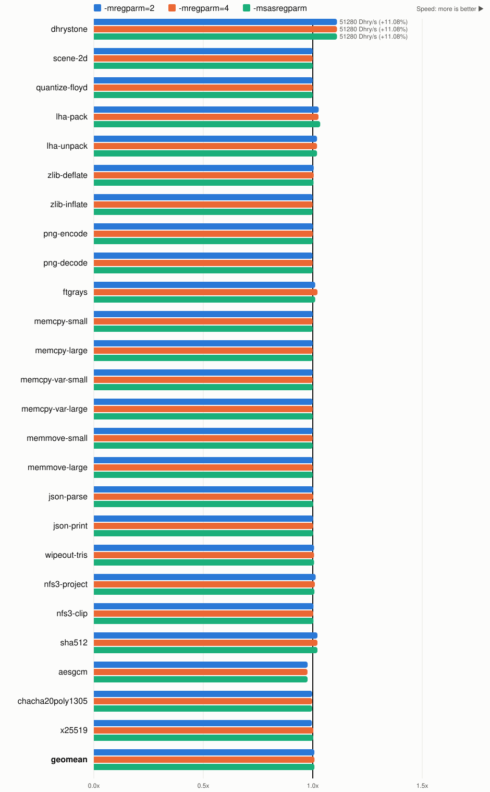

# GCC register arguments

Part of the [Benchwork results](README.md); see there for how they are
measured.

benchwork-040 built with m68k-amigaos-gcc 16.2-rc26[^rc26] and
`-O2 -fomit-frame-pointer -m68040 -m68881`, with and without
`-mregparm`[^regparm], on the 68040[^volamos].

Passing arguments in registers makes the code 3% smaller and Benchwork 0.7%
faster: call-heavy code gains most (Dhrystone 10%, LHa 2 to 3%, sha512 2%,
ftgrays 1 to 2%), and only aesgcm loses more than 0.4%: 2.4%. Allowing four register
arguments instead of two changes little, and so does `-msasregparm`, which
puts a third integer or pointer argument on the stack instead of in a
register of the other kind.

Each bar is the stack-argument build's time divided by the build's, so
longer is faster; stack arguments are the line at 1.0.

| benchmark | stack args | -mregparm=2 | -mregparm=4 | -msasregparm |
|---|---:|---:|---:|---:|
| dhrystone | 433 | **390 (-9.97%)** | **390 (-9.97%)** | **390 (-9.97%)** |
| scene-2d | **1017** | **1017** | **1017** | **1017** |
| quantize-floyd | **658** | **658** | **658** | **658** |
| lha-pack | 1103 | 1074 (-2.63%) | 1075 (-2.56%) | **1067 (-3.30%)** |
| lha-unpack | 297 | **292 (-1.91%)** | **292 (-1.91%)** | **292 (-1.91%)** |
| zlib-deflate | 803 | **799 (-0.45%)** | **799 (-0.45%)** | 800 (-0.36%) |
| zlib-inflate | **205** | **205 (+0.03%)** | **205 (+0.03%)** | **205 (+0.03%)** |
| png-encode | 1291 | **1290 (-0.07%)** | **1290 (-0.07%)** | **1290 (-0.05%)** |
| png-decode | 979 | 979 (+0.07%) | 979 (+0.03%) | **978 (-0.03%)** |
| ftgrays | 656 | 649 (-1.11%) | **642 (-2.11%)** | 649 (-1.10%) |
| memcpy-small | **852** | **852** | **852** | **852** |
| memcpy-large | **285** | **285** | **285** | **285** |
| memcpy-var-small | **515** | **515** | **515** | **515** |
| memcpy-var-large | **592** | **592** | **592** | **592** |
| memmove-small | **909** | **909** | **909** | **909** |
| memmove-large | **957** | **957** | **957** | **957** |
| json-parse | 412 | **411 (-0.22%)** | **411 (-0.22%)** | **411 (-0.22%)** |
| json-print | 262 | **261 (-0.16%)** | **261 (-0.16%)** | **261 (-0.16%)** |
| wipeout-tris | 873 | **868 (-0.58%)** | **868 (-0.58%)** | **868 (-0.58%)** |
| nfs3-project | 1058 | **1044 (-1.32%)** | 1048 (-0.95%) | 1050 (-0.76%) |
| nfs3-clip | 965 | **962 (-0.33%)** | 963 (-0.20%) | **962 (-0.33%)** |
| sha512 | 1042 | **1020 (-2.09%)** | **1020 (-2.09%)** | **1020 (-2.09%)** |
| aesgcm | **803** | 822 (+2.38%) | 822 (+2.45%) | 822 (+2.42%) |
| chacha20poly1305 | **401** | 402 (+0.27%) | 402 (+0.27%) | 402 (+0.26%) |
| x25519 | 547 | 549 (+0.39%) | **545 (-0.29%)** | 546 (-0.20%) |
| **GEOMEAN** | **641** | **636 (-0.73%)** | **636 (-0.78%)** | **636 (-0.76%)** |
| **CODE SIZE** | 443152 | 430684 (-2.81%) | 429152 (-3.16%) | 431392 (-2.65%) |

[^volamos]: `volamos --clock-mhz 25 --cpu 68040 --fpu <binary> REPEAT 2`,
    each repetition looping for at least a second (`MINTIME`'s default).
    The emulated time is derived from the CPU's cycle count at 25 MHz;
    native library calls cost no cycles.
[^rc26]: `m68k-amigaos-gcc (AmigaDev 16.2-rc26) 16.2.1b 20261010182711`,
    with its default newlib runtime.
[^regparm]: The whole program is built with `-mregparm`; newlib, which
    is not, keeps stack arguments because its headers declare its
    functions `__stdargs`.
