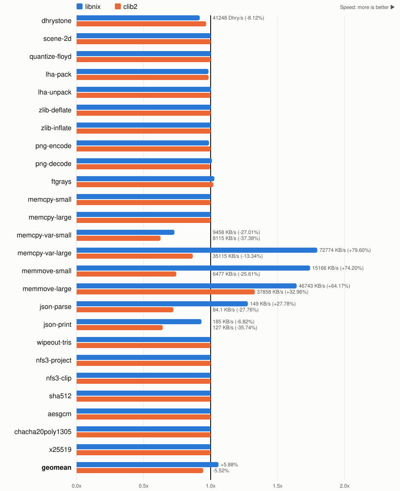

# Comparing C runtimes

Part of the [Benchwork results](README.md); see there for how they are
measured.

benchwork-040 built with `-O2 -fomit-frame-pointer -m68020-60 -m68881` and
each of m68k-amigaos-gcc's C runtimes: newlib, its default, libnix
(`-mcrt=nix20`) and clib2 (`-mcrt=clib2`), by 16.2-rc23[^rc23]. Unlike the
other pages, this one is measured on Amiberry, cycle-exact, running AmigaOS
3.2.3[^amiberry]: libnix's `memcpy()` and `realloc()` call exec's
`CopyMem()`, which volamos runs natively in no time at all.

libnix takes 6% less time than newlib and makes the program 14% smaller;
clib2 takes 6% more and is 11% smaller. The copies and JSON decide it:

- libnix's `memcpy()` is a call to `CopyMem()`: the fastest for large
  copies, but the library call makes small ones take 37% longer.
- libnix's `memmove()` is an unrolled loop of long moves, which takes 40%
  less time than newlib's.
- clib2's copies are the slowest but for large moves.
- json-parse, a `malloc()` for every value and a `strtod()` for every
  number, takes 22% less time with libnix and 38% more with clib2.
  newlib's time depends on what ran before it: 419 ms here, after the
  other benchmarks have used the heap, and 372 ms run on its own.
- json-print, a `sprintf()` for every number, takes 7% longer with libnix
  and 56% longer with clib2.

Dhrystone, which calls `strcpy()` and `strcmp()` in every loop, takes 9%
longer with libnix and 3% longer with clib2. Every other benchmark is
within 3% of newlib.

Each bar is newlib's time divided by the runtime's, so longer is faster;
newlib is the line at 1.0.

| benchmark | newlib | libnix | clib2 |
|---|---:|---:|---:|
| dhrystone | **445** | 485 (+8.84%) | 461 (+3.47%) |
| scene-2d | **736** | **736** | **736** |
| quantize-floyd | 889 | **887 (-0.14%)** | 888 (-0.06%) |
| lha-pack | **1115** | 1134 (+1.65%) | 1133 (+1.56%) |
| lha-unpack | 311 | **310 (-0.32%)** | 311 (+0.02%) |
| zlib-deflate | 925 | **923 (-0.23%)** | 924 (-0.10%) |
| zlib-inflate | **317** | **317 (-0.21%)** | **317 (-0.10%)** |
| png-encode | 1732 | 1753 (+1.21%) | **1731 (-0.03%)** |
| png-decode | 1278 | **1265 (-0.95%)** | 1282 (+0.31%) |
| ftgrays | 666 | **648 (-2.70%)** | 653 (-1.95%) |
| memcpy-small | **1350** | **1350** | **1350** |
| memcpy-large | **449** | **449** | **449 (-0.01%)** |
| memcpy-var-small | **579** | 794 (+37.01%) | 925 (+59.69%) |
| memcpy-var-large | 739 | **412 (-44.32%)** | 853 (+15.39%) |
| memmove-small | 804 | **462 (-42.60%)** | 1081 (+34.42%) |
| memmove-large | 1011 | **616 (-39.09%)** | 761 (-24.79%) |
| json-parse | 419 | **328 (-21.74%)** | 580 (+38.43%) |
| json-print | **246** | 264 (+7.32%) | 382 (+55.61%) |
| wipeout-tris | **1146** | **1146 (+0.01%)** | **1146 (+0.01%)** |
| nfs3-project | **1191** | **1191** | **1191** |
| nfs3-clip | **999** | **999** | **999** |
| sha512 | **1670** | **1670** | **1670** |
| aesgcm | 1161 | 1161 (-0.01%) | **1160 (-0.05%)** |
| chacha20poly1305 | **1108** | **1108 (+0.01%)** | **1108** |
| x25519 | **3018** | 3019 (+0.03%) | **3018** |
| **GEOMEAN** | **826** | **780 (-5.55%)** | **874 (+5.84%)** |
| **CODE SIZE** | 458108 | 395660 (-13.63%) | 408072 (-10.92%) |

## JSON across releases

json-parse and json-print alone, built the same way by rc21, rc22 and
rc23, each time in ms with its change from the release before:

- newlib parses the same in all three, and prints 4% faster since rc22.
- libnix parses 22% slower and prints 61% slower since rc22, which
  brought its new printf and scanf engines. rc21's are faster but less
  exact: it reads some of these numbers a bit differently, so its
  json-parse check value differs from every other build's.
- The clib2 of rc21 and rc22 hangs the machine in the benchmarks' setup.
- ixemul (`-mcrt=ixemul`) cannot build Benchwork in any of them: libpng
  finds no `ptrdiff_t` in its headers, and the NFS3 kernels' C++ headers
  clash with them.

| json-parse | rc21 | rc22 | rc23 |
|---|---:|---:|---:|
| newlib | 372 | 372 (+0.13%) | 372 (+0.01%) |
| libnix | 271 | 330 (+22.07%) | 327 (-0.93%) |
| clib2 | hangs | hangs | 580 |

| json-print | rc21 | rc22 | rc23 |
|---|---:|---:|---:|
| newlib | 256 | 246 (-3.83%) | 246 |
| libnix | 163 | 263 (+61.22%) | 264 (+0.21%) |
| clib2 | hangs | hangs | 382 |

[^rc23]: `m68k-amigaos-gcc (AmigaDev 16.2-rc23) 16.2.1b 20261010182711`,
    the release tarball.
[^amiberry]: Amiberry be174e7de, after v8.5.0: an A4000 with a 25 MHz
    68040, `cpu_cycle_exact`, 2 MB of chip and 128 MB of motherboard RAM,
    Kickstart 47.115 and Workbench 3.2.3. Each benchmark is the fastest of
    three repetitions, of at least a second each.
