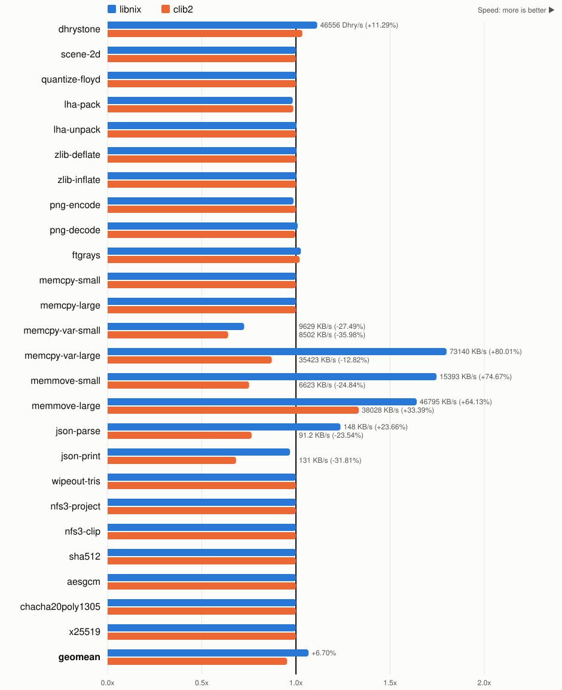

# Comparing C runtimes

Part of the [Benchwork results](README.md); see there for how they are
measured.

benchwork-040 built with `-O2 -fomit-frame-pointer -m68020-60 -m68881` and
each of m68k-amigaos-gcc's C runtimes: newlib, its default, libnix
(`-mcrt=nix20`) and clib2 (`-mcrt=clib2`), by 16.2-rc26[^rc26]. Unlike the
other pages, this one is measured on Amiberry, cycle-exact, running AmigaOS
3.2.3[^amiberry]: libnix's `memcpy()` and `realloc()` call exec's
`CopyMem()`, which volamos runs natively in no time at all.

libnix takes 6% less time than newlib and makes the program 13% smaller;
clib2 takes 5% more and is 10% smaller. The copies and JSON decide it:

- libnix's `memcpy()` is a call to `CopyMem()`: the fastest for large
  copies, but the library call makes small ones take 38% longer.
- libnix's `memmove()` is an unrolled loop of long moves, which takes 40%
  less time than newlib's.
- clib2's copies are the slowest but for large moves.
- json-parse, a `malloc()` for every value and a `strtod()` for every
  number, takes 19% less time with libnix and 31% more with clib2.
  newlib's time depends on the state of the heap: 409 ms here, after the
  other benchmarks have used it, and 433 ms run on its own.
- json-print, a `sprintf()` for every number, takes 3% longer with libnix
  and 47% longer with clib2.

Dhrystone, which calls `strcpy()` and `strcmp()` in every loop, takes 10%
less time with libnix and 3% less with clib2. Every other benchmark is
within 3% of newlib.

Each bar is newlib's time divided by the runtime's, so longer is faster;
newlib is the line at 1.0.

| benchmark | newlib | libnix | clib2 |
|---|---:|---:|---:|
| dhrystone | 478 | **430 (-10.14%)** | 462 (-3.29%) |
| scene-2d | **691** | **691** | **691** |
| quantize-floyd | 893 | **892 (-0.13%)** | 893 (-0.06%) |
| lha-pack | **1091** | 1110 (+1.72%) | 1107 (+1.43%) |
| lha-unpack | 309 | **308 (-0.32%)** | 309 (+0.01%) |
| zlib-deflate | 915 | **913 (-0.23%)** | 914 (-0.10%) |
| zlib-inflate | 295 | **294 (-0.21%)** | **294 (-0.08%)** |
| png-encode | **1654** | 1675 (+1.27%) | **1654 (-0.02%)** |
| png-decode | 1278 | **1266 (-0.93%)** | 1282 (+0.33%) |
| ftgrays | 652 | **636 (-2.56%)** | 640 (-1.92%) |
| memcpy-small | **1252** | **1252** | **1252** |
| memcpy-large | **449** | **449 (-0.01%)** | **449** |
| memcpy-var-small | **565** | 780 (+37.92%) | 883 (+56.21%) |
| memcpy-var-large | 737 | **410 (-44.45%)** | 846 (+14.70%) |
| memmove-small | 794 | **455 (-42.75%)** | 1057 (+33.06%) |
| memmove-large | 1010 | **615 (-39.07%)** | 757 (-25.03%) |
| json-parse | 409 | **331 (-19.13%)** | 535 (+30.78%) |
| json-print | **254** | 262 (+3.25%) | 372 (+46.65%) |
| wipeout-tris | **3399** | **3399** | **3399** |
| nfs3-project | **3019** | **3019** | **3019** |
| nfs3-clip | **2145** | **2145** | **2145** |
| sha512 | **1817** | **1817** | **1817** |
| aesgcm | **1197** | **1197** | **1197 (-0.05%)** |
| chacha20poly1305 | **814** | **814** | **814** |
| x25519 | **1838** | 1839 (+0.05%) | **1838** |
| **GEOMEAN** | **888** | **832 (-6.28%)** | **932 (+4.89%)** |
| **CODE SIZE** | 457972 | 398236 (-13.04%) | 410592 (-10.35%) |

## JSON across releases

json-parse and json-print alone, built the same way by each release from
rc21 to rc26, each time in ms with its change from the release before:

- newlib parses within 2.2% in all six, and prints 4% faster since rc22.
- libnix parses 15% slower and prints 34% slower since rc22, which
  brought its new printf and scanf engines.
- From rc23 on, no runtime moves either benchmark by more than 2.2%.
- The clib2 of rc21 and rc22 hangs the machine in the benchmarks' setup.
- ixemul (`-mcrt=ixemul`) cannot build Benchwork in any of them: libpng
  finds no `ptrdiff_t` in its headers, and the NFS3 kernels' C++ headers
  clash with them.

| json-parse | rc21 | rc22 | rc23 | rc24 | rc25 | rc26 |
|---|---:|---:|---:|---:|---:|---:|
| newlib | 439 | 439 (-0.01%) | 439 (+0.01%) | 441 (+0.40%) | 431 (-2.16%) | 433 (+0.28%) |
| libnix | 282 | 324 (+14.63%) | 320 (-0.95%) | 327 (+2.17%) | 329 (+0.40%) | 330 (+0.33%) |
| clib2 | hangs | hangs | 536 | 538 (+0.36%) | 534 (-0.63%) | 535 (+0.15%) |

| json-print | rc21 | rc22 | rc23 | rc24 | rc25 | rc26 |
|---|---:|---:|---:|---:|---:|---:|
| newlib | 263 | 253 (-3.78%) | 253 | 253 (-0.19%) | 250 (-0.91%) | 254 (+1.32%) |
| libnix | 190 | 254 (+33.90%) | 255 (+0.20%) | 259 (+1.45%) | 263 (+1.47%) | 262 (-0.20%) |
| clib2 | hangs | hangs | 374 | 374 (-0.10%) | 369 (-1.46%) | 372 (+0.95%) |

[^rc26]: `m68k-amigaos-gcc (AmigaDev 16.2-rc26) 16.2.1b 20261010182711`,
    the release tarball.
[^amiberry]: Amiberry 0f97f686a, after v8.5.0 (it reports 8.6.0): an A4000 with a 25 MHz
    68040, `cpu_cycle_exact`, 2 MB of chip and 128 MB of motherboard RAM,
    Kickstart 47.115 and Workbench 3.2.3. Each benchmark is the fastest of
    three repetitions, of at least a second each.
